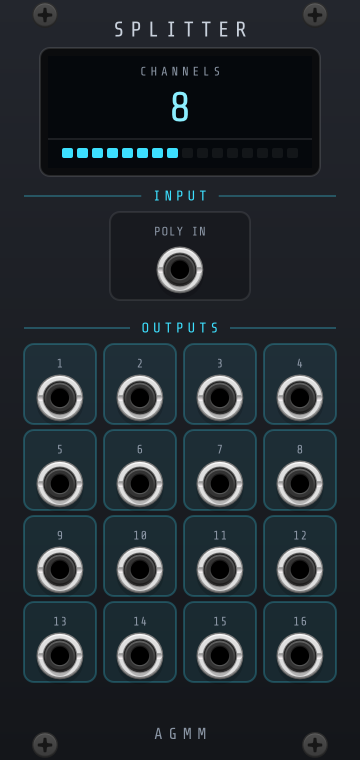

<!--
AGMM AUTOMATIC DOCUMENTATION
Source: Splitter.cpp
-->

# Splitter

## 1. Overview

`Splitter` is a 12 HP utility that expands a single polyphonic input into sixteen monophonic outputs. Every output jack carries one channel of the incoming polyphonic signal (or 0 V if that channel isn't present), so the module can be used to break a polyphonic patch apart into individual voices, for example to route each channel through its own effect.

Key features:
- 1 poly input → 16 mono outputs
- Channel count display with 16-segment bar
- Simple, stateless design

## Module Screenshot



## 2. Architecture

### Main Classes

- `Splitter`: Core module class inheriting from `rack::Module`
- `SLPanelBackground`: Static panel artwork
- `SLDisplayWidget`: Live channel count + segment bar

### Inheritance

- `Splitter` inherits from `rack::Module`
- Both UI widgets inherit from `rack::TransparentWidget`

### State

| Group | Storage |
|-------|---------|
| Display | `int channels` |

That's it — the module is essentially stateless.

## 3. DSP Theory

### The splitter is a pure router

Each sample, the module reads the channel count of the poly input, then writes each channel to its matching mono output. Channels that aren't present on the input carry 0 V.

This is the inverse of `Merger`: instead of combining mono inputs into a poly cable, it takes a poly cable apart.

## 4. Parameters and Controls

### Knobs

None.

### Buttons

None.

### Inputs

| Input | Description |
|-------|-------------|
| `POLY_INPUT` | Polyphonic input |

### Outputs

| Output | Description |
|--------|-------------|
| `SPLIT_OUTPUT + 0..15` | 16 monophonic outputs |

### Enumerations

- `ParamId`: (none)
- `InputId`: POLY_INPUT
- `OutputId`: `ENUMS(SPLIT_OUTPUT, 16)`
- `LightId`: (none)

## 5. Inputs and Outputs

### Input

| Name | Type | Range | Description |
|------|------|-------|-------------|
| `POLY_INPUT` | Poly | ±10 V | Polyphonic input (1..16 channels) |

### Outputs

| Name | Type | Range | Description |
|------|------|-------|-------------|
| `SPLIT_OUTPUT + 0..15` | Mono | ±10 V | One channel per output |

### Channel Mapping

Output `i` always carries channel `i` of the input (or 0 V if `i >= channels`). This is stable: adding/removing channels on the input doesn't shift the other outputs.

## 6. Signal Processing Pipeline

The entire pipeline is 3 lines:

```cpp
int ch = inputs[POLY_INPUT].isConnected() ? inputs[POLY_INPUT].getChannels() : 0;
channels = ch;

for (int i = 0; i < 16; ++i) {
    outputs[SPLIT_OUTPUT + i].setChannels(1);
    outputs[SPLIT_OUTPUT + i].setVoltage(i < ch ? inputs[POLY_INPUT].getVoltage(i) : 0.f);
}
```

1. Read channel count.
2. For each of the 16 outputs, set mono and write the channel (or 0 V).

## 7. Important Functions

### `process(const ProcessArgs &args)`

The only function.

## 8. Mathematical Implementation

No mathematical processing — the module is a pure router.

The only "computation" is the loop over 16 outputs.

## 9. Performance and Optimization

### CPU Usage

- 1 `isConnected()` + 1 `getChannels()` + 16 `getVoltage()` + 16 `setVoltage()` ≈ 40 ops/sample

### Memory Allocation

- No allocation ever
- Fixed-size state

### Buffers

- `int channels`: 4 bytes

### Real-time Processing

- O(16) per sample, bounded
- No allocation, no blocking

### Thread Safety

- `channels` written by audio thread, read by UI thread via torn reads

### Numerical Stability

- Pure copies, no math
- Output clamped to ±10 V by Rack

## 10. Dependencies

### Libraries/Headers

- `plugin.hpp` — VCV Rack core
- `agmm_ui.hpp` — shared AGMM UI helpers
- `<cmath>`, `<cstdio>`, `<cstring>`, `<algorithm>`, `<memory>`

### External Classes

- `rack::Module`, `rack::TransparentWidget`, `rack::engine::ParamQuantity`
- `agmm::panelBase`, `agmm::bezel`, `agmm::cell`, `agmm::text`, `agmm::screen`, `agmm::sectionHeader`, `agmm::withA`, `agmm::accent`, `agmm::bright`, `agmm::dim`, `agmm::ALIGN_L/C/R`

## 11. Summary

`Splitter` is the inverse of `Merger`: it takes a polyphonic cable apart into 16 monophonic signals. It's essential for routing polyphonic patches through monophonic modules (each voice through its own effect, then back through a `Merger`).

The design choice of stable channel mapping (output i always = channel i) is crucial: without it, adding or removing a cable on the input would re-pitch every downstream voice. With it, you can freely patch/unpatch without affecting the other outputs.

The main limitation is that it's a "dumb" splitter: no gain, no offset, no CV. For those features, use a mixer per channel. But for pure splitting, this is exactly right.