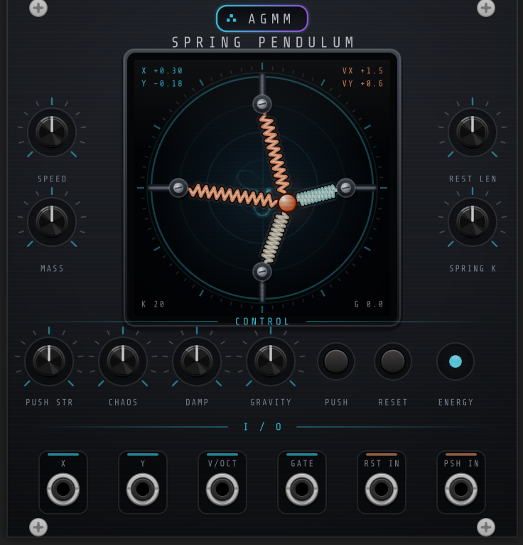

<!--
AGMM AUTOMATIC DOCUMENTATION
Source: SpringPendulum.cpp
Generated: 2026-11-04 06:33
-->

This code defines a VCV Rack module for a **Spring Pendulum** simulation, which models the physics of a mass attached to a spring that can oscillate in two dimensions. Here's a breakdown of its components and functionality:

---

### 🧠 **Overview**

The `SpringPendulum` module simulates a 2D spring pendulum system with:
- A central anchor point
- A mass (bob) connected by a spring
- Physics parameters like mass, spring constant, damping, gravity, etc.
- Interactive controls for manipulation and visualization

It includes:
- A **visual display** widget showing the motion of the bob in real-time.
- **Interactive mouse control**: Clicking and dragging the bob to reposition it manually.
- **Audio outputs** for position (`X`, `Y`) and voltage-controlled pitch (`V/OCT`), gate output, reset input, and push input.
- A **context menu** for configuring Voct range and Gate duration.

## Module Screenshot



---

### 📦 **Key Components**

#### 1. **Module Class: `SpringPendulum`**
This is the core logic class that handles:
- Simulation of physics (position, velocity, forces)
- Trail tracking for visual effect
- Input/output handling
- Parameter management (`SPEED`, `MASS`, `LENGTH`, etc.)
- Mouse interaction state (`grabbed`, `grabX`, `grabY`)
- Randomization and reset behavior

##### Parameters:
| Param ID | Name             | Description |
|----------|------------------|-------------|
| SPEED_PARAM     | Speed            | Controls simulation speed |
| MASS_PARAM      | Mass             | Adjusts the mass of the bob |
| LENGTH_PARAM    | Rest Length      | Sets the rest length of the spring |
| SPRING_K_PARAM  | Spring K         | Spring stiffness |
| PUSH_STRENGTH_PARAM | Push Strength | Strength of manual push |
| CHAOS_PARAM     | Chaos            | Adds chaotic behavior to motion |
| DAMP_PARAM      | Damping          | Amount of energy loss per frame |
| GRAVITY_PARAM   | Gravity          | Vertical gravitational force |
| PUSH_BUTTON     | Push Button      | Triggers a push event |
| RESET_BUTTON    | Reset Button     | Resets the simulation |

##### Outputs:
| Output ID        | Name         | Description |
|------------------|--------------|-------------|
| X_OUTPUT         | X            | Horizontal position output |
| Y_OUTPUT         | Y            | Vertical position output |
| VOCT_OUTPUT      | V/OCT        | Voltage-controlled pitch output |
| GATE_OUTPUT      | Gate         | Trigger gate when bob crosses threshold |

##### Inputs:
| Input ID              | Name           | Description |
|-----------------------|----------------|-------------|
| RESET_CV_INPUT        | Reset CV       | External reset trigger |
| PUSH_CV_INPUT         | Push CV        | External push control |

---

#### 2. **Display Widget: `SPDisplayWidget`**
Visualizes the simulation in a dial-like interface:
- Shows the bob moving within a circular area
- Displays trails of past positions
- Draws springs from anchor points to the bob
- Highlights grabbed state with a ring around the ball
- Shows real-time values (X, Y, VX, VY, K, G)
- Includes energy glow effect based on velocity

##### Features:
- **Interactive dragging**: Click and drag the bob to manually control it.
- **Trail rendering**: Visual history of motion.
- **Spring visualization**: Four springs from anchor points with tension-based coloring.
- **Readouts**: Corner labels showing current values.

---

#### 3. **Panel Background: `SPPanelBackground`**
Draws the module's panel layout:
- Gradient background
- Brushed metal texture
- Vignette effects
- Corner accents and edge highlights
- Labels for knobs and controls

##### Layout Constants:
```cpp
const float SP_PANEL_W = 300.f;
const float SP_PANEL_H = 380.f;

// Display area
const float SP_DISP_X = 150.f - 90.f;
const float SP_DISP_Y = 120.f;
const float SP_DISP_W = 180.f;
const float SP_DISP_H = 180.f;

// Knob positions
const float SP_LKNOB_X = 60.f;
const float SP_RKNOB_X = 240.f;
const float SP_KNOB_Y1 = 50.f;
const float SP_KNOB_Y2 = 90.f;

// Control row
const float SP_CTRL_SECTION_Y = 230.f;
const float SP_CTRL_Y = 260.f;
const float SP_CTRL_LBL_Y = 280.f;

// I/O section
const float SP_IO_SECTION_Y = 310.f;
const float SP_IO_Y = 340.f;
```

---

#### 4. **Context Menu Options**
Adds configuration options via right-click menu:
- **Voct Range**: Choose how the `V/OCT` output maps to pitch (e.g., 0–1, -2 to 2).
- **Gate Duration**: Set how long the gate output stays active after triggering.

---

### 🎮 **Usage Instructions**

#### Controls:
- **Knobs**:
  - **Speed**: Adjust simulation speed.
  - **Mass**: Change the mass of the bob.
  - **Rest Length**: Modify spring rest length.
  - **Spring K**: Tune spring stiffness.
  - **Push Strength**: Control how hard a push is applied.
  - **Chaos**: Introduce randomness into motion.
  - **Damp**: Add damping to reduce oscillation.
  - **Gravity**: Apply vertical gravity force.

- **Buttons**:
  - **Push**: Instantly apply a push to the bob.
  - **Reset**: Reset the simulation state.
  - **Energy Light**: Indicates when energy is high (e.g., fast movement).

#### I/O:
- **Outputs**:
  - `X`, `Y`: Position in normalized coordinates.
  - `V/OCT`: Voltage representing pitch based on position.
  - `Gate`: Triggered when the bob crosses a threshold.
- **Inputs**:
  - `Reset CV`: External trigger to reset simulation.
  - `Push CV`: Apply push force via CV.

---

### 🔧 **Technical Notes**

#### Physics Simulation
The module uses a simplified physics engine:
- Position and velocity update using Euler integration.
- Spring force calculation: $ F = k(x - x_0) $
- Gravity applied as a constant downward acceleration.
- Damping reduces velocity over time.
- Chaos introduces small random perturbations.

#### Visualization
- Uses NanoVG for vector graphics rendering.
- Trails are stored in a circular buffer (`trailX`, `trailY`).
- Springs drawn using custom `drawSpring()` function with multiple segments.
- Bob size scales with mass using cube root mapping.

---

### 🖼️ **Visual Design**

The UI features:
- Metallic panel with brushed texture
- Circular display with radial ticks and crosshair
- Glowing energy effect during fast motion
- Scanlines for CRT-like feel
- Glass reflection overlay
- Color-coded readouts (cyan for position, orange for velocity, gray for parameters)

---

### 🧪 **Example Use Cases**

1. **Modular Synthesis**: Use `X/Y` outputs to modulate filter cutoffs or LFO rates.
2. **Audio Generation**: Route `V/OCT` to a VCO for evolving pitch sequences.
3. **Performance Art**: Drag the bob manually to create interactive soundscapes.
4. **Educational Tool**: Visualize spring-mass systems in physics classes.

---

### 🧰 **Dependencies**

This module requires:
- [VCV Rack SDK](https://vcvrack.com/)
- NanoVG for vector graphics
- Standard C++17 features

---

Let me know if you'd like help compiling this, modifying it, or understanding specific parts like the physics engine or drawing functions!