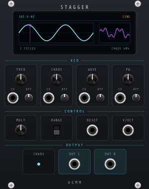

<!--
AGMM AUTOMATIC DOCUMENTATION
Source: Stagger.cpp
-->

# Stagger

## 1. Overview

`Stagger` is a 20 HP polyphonic VCO with a stereo "chaos" pitch drift. Each voice runs two independent oscillators (L and R) whose pitch is the base pitch plus a slow, filtered random drift — so the two channels slowly detune against each other, giving a wide, unstable, "staggering" tone.

Key features:
- Polyphonic VCO with independent L/R drift
- 4 waveforms: Sine, Triangle, Saw, Square (minBLEP anti-aliased)
- Pulse-width control for square
- Chaos multiplier (×1, ×2, ×3, ×5, ×10)
- CV range selectable (±5 V or ±10 V)
- CV + attenuverter on pitch, chaos, waveform and pulse width
- Reset input for the chaos drift
- Editable frequency field (Hz or note name)
- Scope + chaos drift history display

## Module Screenshot



## 2. Architecture

### Main Classes

- `Stagger`: Core module class inheriting from `rack::Module`
- `StFreqQ`: Custom ParamQuantity for the frequency knob
- `STPanel`: Static panel artwork
- `STDisplay`: Live scope + drift history display

### Inheritance

- `Stagger` inherits from `rack::Module`
- Both UI widgets inherit from `rack::TransparentWidget`

### Structures

- `Voice { phase, lastPhase, blepRising, blepFalling, blepSaw, phaseR, lastPhaseR, blepRisingR, blepFallingR, blepSawR }` — one voice with L and R channels

### State (grouped)

| Group | Storage |
|-------|---------|
| Voices | `std::vector<Voice> voices` |
| Chaos drift | `float chaosDrift`, `chaosDriftR` |
| RNG | `std::mt19937 rng`, `std::uniform_real_distribution<float> dist` |
| Transport | `bool cvRangeTenVolt`, `float lastResetVoltage` |
| Display | `float dispFreq, dispPw, dispPhase, dispChaos`, `int dispWave`, `int dispChannels`, `float driftHist[128]`, `int driftHead`, `float driftTimer, driftPeak` |

## 3. DSP Theory

### Stagger concept

The name "Stagger" refers to the way the two channels slowly drift apart in pitch. Each voice runs two oscillators — one for L, one for R — with independent filtered random drift:

$$
f_L = f_{\text{base}} + \text{chaos}_L \cdot \text{mult}
$$

$$
f_R = f_{\text{base}} + \text{chaos}_R \cdot \text{mult}
$$

where $\text{chaos}_L$ and $\text{chaos}_R$ are independent one-pole filtered white noise:

$$
\text{chaos}_L \leftarrow (1 - \alpha) \cdot \text{chaos}_L + \alpha \cdot w_L
$$

with $\alpha = \min(2\pi f_c/f_s, 0.5)$ and $f_c = 1.5$ Hz. The slow filter makes the drift smooth (like tape wow/flutter).

### Pitch computation

$$
\text{pitch} = \text{basePitch} + \text{V/Oct} + \text{pitchCV} \cdot \text{atten} + \text{chaos} \cdot \text{depth} \cdot \text{mult}
$$

### Fast 2^x approximation

Instead of `pow(2, x)`, the module uses a bit-twiddling approximation:

```cpp
union { float f; uint32_t i; } u;
u.i = (uint32_t)((1 << 23) * (x + 126.94269504f));
return u.f;
```

This is accurate to ~1e-3 relative error, which is good enough for pitch.

### Waveforms

- **Sine**: $\sin(2\pi\phi)$
- **Triangle**: $1 - 4|\phi - 0.5|$ with a 90° phase shift (so it starts at 0)
- **Saw**: $1 - 2\phi$, with minBLEP correction at wrap
- **Square**: $(\phi < pw ? 1 : -1)$, with minBLEP correction at both edges

### minBLEP

The minBLEP (minimum band-limited step) is a correction applied at discontinuities to reduce aliasing. For a saw wrap, it inserts a 2.0 discontinuity; for a square edge, it inserts a ±2.0 discontinuity. The DSP then adds the minBLEP output to the raw waveform.

### Chaos multiplier

The multiplier is selected from a discrete table:

$$
\text{mult} = \{1, 2, 3, 5, 10\}
$$

So the chaos drift can be subtle (×1) or extreme (×10).

### Pulse width

The square pulse width is adjustable from 0.01 to 0.99:

$$
\text{pw} = \text{clamp}(\text{knob} + \text{pwCV} \cdot \text{atten} / 10, 0.01, 0.99)
$$

### CV range

The CV range switch toggles between ±5 V (scale = 1) and ±10 V (scale = 0.5). This affects all CV inputs.

## 4. Parameters and Controls

### Knobs

| Parameter | Min | Max | Default | Description |
|-----------|-----|-----|---------|-------------|
| `PITCH_PARAM` | 0 | 1 | 0.5 | Frequency (10 Hz .. 6 kHz) |
| `CHAOS_PARAM` | 0 | 1 | 0 | Chaos depth |
| `WAVE_PARAM` | 0 | 3 | 0 | Waveform |
| `PW_PARAM` | 0 | 1 | 0.5 | Pulse width |
| `CHAOS_MULT_PARAM` | 0 | 4 | 0 | Chaos multiplier |
| `PITCH_ATTEN_PARAM` | −1 | 1 | 0 | Pitch CV attenuverter |
| `CHAOS_ATTEN_PARAM` | −1 | 1 | 0 | Chaos CV attenuverter |
| `WAVE_ATTEN_PARAM` | −1 | 1 | 0 | Wave CV attenuverter |
| `PW_ATTEN_PARAM` | −1 | 1 | 0 | Pulse width CV attenuverter |

### Switches

| Parameter | Description |
|-----------|-------------|
| `CV_RANGE_PARAM` | ±5 V or ±10 V |

### Inputs

| Input | Description |
|-------|-------------|
| `CV_INPUT` | 1 V/oct pitch |
| `PITCH_CV_INPUT` | Pitch modulation CV |
| `CHAOS_CV_INPUT` | Chaos CV |
| `WAVE_CV_INPUT` | Waveform select CV |
| `PW_CV_INPUT` | Pulse width CV |
| `CHAOS_RESET_INPUT` | Reset chaos drift |

### Outputs

| Output | Description |
|--------|-------------|
| `VCO_L_OUTPUT` | Left |
| `VCO_R_OUTPUT` | Right |

### Lights

- `CHAOS_LIGHT` — Chaos activity

### Menu

- Frequency (Hz or note name)
- Display mode (Note or Hz)

### Enumerations

- `ParamId`: Pitch, Chaos, ChaosMult, Wave, PW, PitchAtten, ChaosAtten, WaveAtten, PWAtten, CVRange
- `InputId`: VOct, PitchCV, ChaosCV, WaveCV, PWCV, ChaosReset
- `OutputId`: OutL, OutR
- `LightId`: Chaos

## 5. Inputs and Outputs

### Inputs

| Name | Type | Range | Description |
|------|------|-------|-------------|
| `CV_INPUT` | CV | 1 V/oct | Pitch (polyphonic) |
| `PITCH_CV_INPUT` | CV | ±10 V | Pitch modulation |
| `CHAOS_CV_INPUT` | CV | ±10 V | Chaos modulation |
| `WAVE_CV_INPUT` | CV | ±10 V | Waveform selection |
| `PW_CV_INPUT` | CV | ±10 V | Pulse width modulation |
| `CHAOS_RESET_INPUT` | Gate | > 1 V | Reset chaos drift |

### Outputs

| Name | Type | Range | Description |
|------|------|-------|-------------|
| `VCO_L_OUTPUT` | Poly Audio | ±5 V | Left (polyphonic) |
| `VCO_R_OUTPUT` | Poly Audio | ±5 V | Right (polyphonic) |

## 6. Signal Processing Pipeline

1. **Read base pitch** from FREQ knob.
2. **Read controls** — Chaos, wave, pulse width, chaos multiplier, CV attens.
3. **CV range scale** — 1.0 for ±5 V, 0.5 for ±10 V.
4. **Chaos reset** — On rising edge, zero both drift values.
5. **Update chaos** — Two independent one-pole filters on white noise.
6. **Determine channels** — `max(1, CV_INPUT channels)`.
7. **Grow voices array** if needed.
8. **For each voice**:
   - Read V/Oct, chaos CV, wave CV, PW CV.
   - Compute total pitch for L and R.
   - Compute frequency with fast 2^x.
   - Compute phase increment.
   - Determine wave index (quantized to 0..3).
   - Determine PW.
   - Render L and R with minBLEP.
   - Write outputs.
9. **LED** — Chaos drift × depth × gain.
10. **Display** — History update.

## 7. Important Functions

### `StFreqQ::setDisplayValueString(std::string s)`

Parses note names ("A4", "C#3") or frequencies ("440") into a knob value.

### `genWave(float &phase, float &lastPhase, int waveIdx, float pw, ...)`

Generates one sample of the waveform with minBLEP corrections.

### `Stagger::process(const ProcessArgs &args)`

The main callback described in §6.

## 8. Mathematical Implementation

### Fast 2^x

```cpp
u.i = (uint32_t)((1 << 23) * (x + 126.94269504f));
```

### Phase increment

$$
\Delta\phi = f \cdot \Delta t
$$

### Frequency (from pitch)

$$
f = 261.626 \cdot 2^{\text{pitch}}
$$

### Chaos filter

$$
\text{chaos} \leftarrow (1 - \alpha) \text{chaos} + \alpha w, \quad \alpha = \min(2\pi f_c/f_s, 0.5)
$$

### Pulse width

$$
pw = \text{clamp}(\text{knob} + \text{cv} \cdot \text{atten}/10, 0.01, 0.99)
$$

### Wave selection

$$
\text{wave} = \text{clamp}(\text{knob} + \text{cv} \cdot \text{atten} \cdot 2/5, 0, 3)
$$

## 9. Performance and Optimization

### CPU Usage

- Per voice: 2 channels × (phase + wave + minBLEP) ≈ 2 × 30 = 60 flops
- Max 16 voices × 60 = 960 flops/sample
- Chaos filters: 4 flops
- Total: ~1000 flops/sample worst case

### Memory Allocation

- `voices` is a `std::vector` that grows to the channel count (max 16)
- `Voice` contains 6 minBLEP generators (each ~64 floats) ≈ 400 bytes/voice
- Total: ~6.4 KB

### Buffers

- `driftHist[128]`: 512 bytes
- Per-voice state: ~400 bytes × 16 = 6.4 KB

### Real-time Processing

- All loops bounded by 16 (voices)
- No allocation after the vector has grown once
- minBLEP is a fixed-size ring buffer

### Thread Safety

- All state written by audio thread, read by UI thread via torn reads

### Numerical Stability

- `fastExp2` is accurate for `x ∈ [-4, 4]` (which covers the pitch range)
- `!std::isfinite` on output resets voice state
- minBLEP keeps the square and saw bounded

## 10. Dependencies

### Libraries/Headers

- `plugin.hpp` — VCV Rack core
- `agmm_ui.hpp` — shared AGMM UI helpers
- `<cmath>`, `<cstdio>`, `<cstring>`, `<cstdint>`, `<vector>`, `<map>`, `<string>`, `<regex>`, `<algorithm>`, `<random>`
- `"dsp/minblep.hpp"` — minBLEP generator

### External Classes

- `rack::Module`, `rack::TransparentWidget`, `rack::engine::ParamQuantity`
- `rack::dsp::MinBlepGenerator<16, 16>`
- `agmm::panelBase`, `agmm::bezel`, `agmm::cell`, `agmm::text`, `agmm::screen`, `agmm::plotFrame`, `agmm::sectionHeader`, `agmm::withA`, `agmm::violet`, `agmm::accent`, `agmm::bright`, `agmm::warm`, `agmm::dim`, `agmm::ALIGN_L/C/R`, `agmm::CyanLight`

## 11. Summary

`Stagger` is a VCO whose defining feature is its **dual-channel drift**: each voice runs two independent oscillators with slow filtered random pitch drift, so the two outputs are never perfectly in tune. This gives a "staggering" stereo effect — the pitch slowly wobbles around the base note, and the L/R channels drift in different directions.

The minBLEP anti-aliasing is essential: without it, the saw and square waves would alias badly at high frequencies. The `dsp::MinBlepGenerator` from Rack handles this efficiently.

The chaos multiplier is a nice touch: ×1 gives subtle drift, ×10 gives wild detuning. The reset input lets you snap back to zero if the drift has wandered too far.

The main limitations are: the drift filter is fixed at 1.5 Hz (no rate control), and the chaos CV is a simple offset (no per-voice independence). But for a "drifty" VCO, this is exactly right.