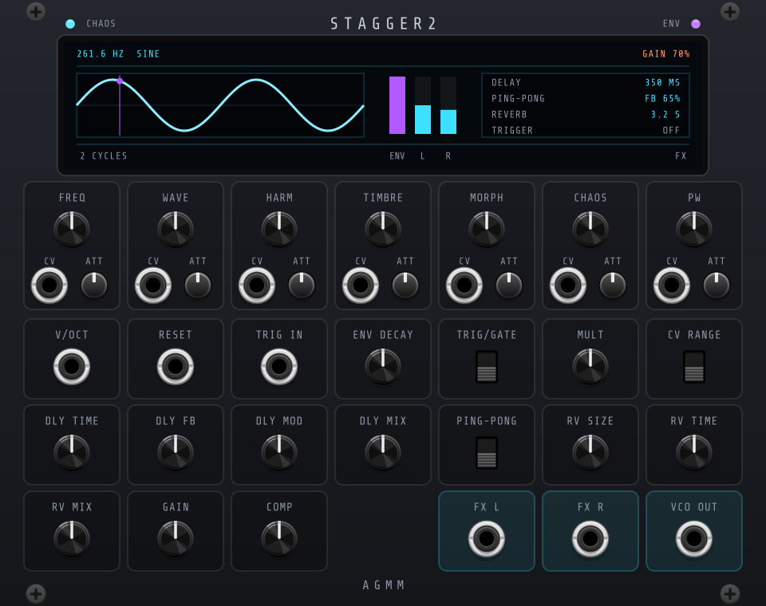

<!--
AGMM AUTOMATIC DOCUMENTATION
Source: Stagger2.cpp
-->

# Stagger2

## 1. Overview

`Stagger2` is a 28 HP expanded version of the Stagger VCO, adding a per-voice modulated stereo delay, an 8-line FDN reverb, a trigger/gate envelope, a master gain stage and a built-in compressor. The core stereo VCO uses the same "chaos drift" concept as Stagger, but the oscillator is now fed through a full space FX chain, and the output is available both as a mono-summed stereo pair (FX L/R) and as a polyphonic VCO+FX output (one voice per 1 V/oct channel).

Key features:
- Polyphonic VCO with independent L/R drift
- Per-voice modulated stereo delay
- Per-voice 8-line FDN reverb
- Per-voice compressor
- Trigger/gate envelope with configurable decay (300 ms / 1 s / 4 s / 12 s)
- Master gain + compressor
- 3 outputs: VCO+FX (poly), FX L (mono), FX R (mono)
- 4 waveforms (Sine, Triangle, Saw, Square) with minBLEP
- Chaos multiplier, CV range, CV + attenuverters on pitch/chaos/wave/PW
- Ping-pong delay mode
- Editable frequency field (Hz or note name)

## Module Screenshot



## 2. Architecture

### Main Classes

- `Stagger2`: Core module class inheriting from `rack::Module`
- `S2FreqQ`, `S2DelayTimeQ`, `S2RevDecayQ`, `S2EnvDecayQ`: Custom ParamQuantity classes
- `S2ModDelay`: Modulated stereo delay line
- `S2Comp`: Peak compressor
- `S2Fdn`: 8-line feedback delay network reverb
- `S2Panel`: Static panel artwork
- `S2Display`: Live display (scope, ENV/L/R meters, FX readout)

### Inheritance

- `Stagger2` inherits from `rack::Module`
- Both UI widgets inherit from `rack::TransparentWidget`

### Structures

- `Voice { phase, lastPhase, blepRising, blepFalling, blepSaw, delay, reverb, comp, env, gateHigh, lastTrig }` — one voice with FX

### State (grouped)

| Group | Storage |
|-------|---------|
| Voices | `std::vector<Voice> voices` |
| Master comps | `S2Comp compL, compR` |
| Chaos drift | `float chaosDrift` |
| RNG | `std::mt19937 rng`, `std::uniform_real_distribution<float> dist` |
| LFOs | `float lfoPhaseA, lfoPhaseB` |
| Transport | `bool cvRangeTenVolt`, `float lastResetVoltage` |
| Display | `float dispFreq, dispPw, dispPhase`, `int dispWave, dispChannels`, `float dispEnv`, `bool dispTrigConn`, `float meterL, meterR` |

## 3. DSP Theory

### Stagger2 = Stagger + FX

The VCO section is identical to `Stagger`: 4 waveforms with minBLEP, dual-channel chaos drift, CV + attenuverters. The difference is the **per-voice FX chain**:

```
VCO → envelope → delay → reverb → compressor → VCO output
              ↓
              └→ FX sum → master compressor → FX L/R output
```

### Per-voice delay

Each voice has its own `S2ModDelay`, a stereo delay with modulated read positions:

$$
\text{readPosL} = \text{delaySamples} + 8 \cdot \text{modDepth} \cdot (\text{lfoA} \cdot 2 - 1)
$$

$$
\text{readPosR} = \text{delaySamples} + 8 \cdot \text{modDepth} \cdot (\text{lfoB} \cdot 2 - 1)
$$

with linear interpolation for the fractional reads, and a one-pole LP in the feedback path.

### Delay feedback

The delay is a **normal stereo delay** (mode 0) or **ping-pong** (mode 1):

- Normal: `outL = in + delayL * fb`, `outR = in + delayR * fb`
- Ping-pong: `outL = in + delayR * fb`, `outR = in + delayL * fb`

The module crossfades between the two modes to avoid clicks.

### Per-voice reverb

Each voice has its own `S2Fdn`, an 8-line feedback delay network with 8 prime-length combs and 4 series allpasses:

$$
\text{wet} = \sum_{i=0}^{7} \text{comb}_i(\text{in}), \quad \text{wet} = \text{ap}_0(\text{ap}_1(\text{ap}_2(\text{ap}_3(\text{wet}))))
$$

The combs have feedback from RT60 and per-line damping.

### Trigger envelope

The envelope is a one-shot attack-decay or gate-sustain, depending on `TRIG_MODE`:

- **Trig mode**: rising edge on `TRIG_INPUT` → env = 1, then decays
- **Gate mode**: gate high → env rises to 1, gate low → env decays
- **No trigger**: env = 1

The decay time is selected from 4 discrete values: 300 ms, 1 s, 4 s, 12 s.

### Compressor

`S2Comp` is a peak compressor with fixed 3 V threshold and adjustable ratio (1:1 to 10:1). Used per-voice (on the VCO+FX output) and master (on the FX outputs).

### Master gain

After the FX chain, the VCO output is multiplied by the master gain and passed through the per-voice compressor.

### FX sum

Each voice's FX output is summed into a stereo bus, which is then compressed by the master compressors and written to the FX L/R outputs.

## 4. Parameters and Controls

### Knobs

| Parameter | Min | Max | Default | Description |
|-----------|-----|-----|---------|-------------|
| `PITCH_PARAM` | 0 | 1 | 0.5 | Frequency |
| `CHAOS_PARAM` | 0 | 1 | 0 | Chaos depth |
| `WAVE_PARAM` | 0 | 3 | 0 | Waveform |
| `PW_PARAM` | 0 | 1 | 0.5 | Pulse width |
| `CHAOS_MULT_PARAM` | 0 | 4 | 0 | Chaos multiplier |
| `DELAY_TIME_PARAM` | 0 | 1 | 0.55 | Delay time (20 ms .. 1.5 s) |
| `DELAY_FB_PARAM` | 0 | 0.92 | 0.65 | Delay feedback |
| `DELAY_MIX_PARAM` | 0 | 1 | 0.6 | Delay mix |
| `DELAY_MOD_PARAM` | 0 | 1 | 0.5 | Delay modulation |
| `REV_SIZE_PARAM` | 0 | 1 | 0.75 | Reverb size |
| `REV_DECAY_PARAM` | 0 | 1 | 0.55 | Reverb decay (0.3–12 s) |
| `REV_MIX_PARAM` | 0 | 1 | 0.75 | Reverb mix |
| `ENV_DECAY_PARAM` | 0 | 3 | 1 | Envelope decay (300 ms / 1 s / 4 s / 12 s) |
| `GAIN_PARAM` | 0 | 2 | 0.7 | Output gain |
| `COMP_PARAM` | 0 | 1 | 0.5 | Compressor |
| `PITCH_ATTEN_PARAM` | −1 | 1 | 0 | Pitch CV atten |
| `CHAOS_ATTEN_PARAM` | −1 | 1 | 0 | Chaos CV atten |
| `WAVE_ATTEN_PARAM` | −1 | 1 | 0 | Wave CV atten |
| `PW_ATTEN_PARAM` | −1 | 1 | 0 | PW CV atten |

### Switches

| Parameter | Description |
|-----------|-------------|
| `CV_RANGE_PARAM` | ±5 V or ±10 V |
| `DELAY_MODE_PARAM` | Normal / Ping-pong |
| `TRIG_MODE_PARAM` | Trig / Gate |

### Inputs

| Input | Description |
|-------|-------------|
| `CV_INPUT` | 1 V/oct |
| `PITCH_CV_INPUT` | Pitch modulation |
| `CHAOS_CV_INPUT` | Chaos modulation |
| `WAVE_CV_INPUT` | Waveform selection |
| `PW_CV_INPUT` | Pulse width modulation |
| `CHAOS_RESET_INPUT` | Reset chaos drift |
| `TRIG_INPUT` | Trigger / gate |

### Outputs

| Output | Description |
|--------|-------------|
| `VCO_OUTPUT` | VCO + FX (polyphonic) |
| `FX_L_OUTPUT` | FX left (mono sum) |
| `FX_R_OUTPUT` | FX right (mono sum) |

### Lights

- `CHAOS_LIGHT` — Chaos activity
- `ENV_LIGHT` — Envelope

### Menu

- Frequency (Hz or note name)
- Display mode (Note or Hz)

### Enumerations

- `ParamId`: Pitch, Chaos, ChaosMult, Wave, PW, PitchAtten, ChaosAtten, WaveAtten, PWAtten, CVRange, DelayTime, DelayFB, DelayMix, DelayMod, DelayMode, RevSize, RevDecay, RevMix, EnvDecay, TrigMode, Gain, Comp
- `InputId`: VOct, PitchCV, ChaosCV, WaveCV, PWCV, ChaosReset, Trig
- `OutputId`: VcoOut, FxL, FxR
- `LightId`: Chaos, Env

## 5. Inputs and Outputs

### Inputs

| Name | Type | Range | Description |
|------|------|-------|-------------|
| `CV_INPUT` | CV | 1 V/oct | Pitch (poly) |
| `PITCH_CV_INPUT` | CV | ±10 V | Pitch mod |
| `CHAOS_CV_INPUT` | CV | ±10 V | Chaos mod |
| `WAVE_CV_INPUT` | CV | ±10 V | Wave select |
| `PW_CV_INPUT` | CV | ±10 V | PW mod |
| `CHAOS_RESET_INPUT` | Gate | > 1 V | Chaos reset |
| `TRIG_INPUT` | Gate | > 1 V | Trigger / gate |

### Outputs

| Name | Type | Range | Description |
|------|------|-------|-------------|
| `VCO_OUTPUT` | Poly Audio | ±10 V | VCO + FX |
| `FX_L_OUTPUT` | Mono Audio | ±10 V | FX left sum |
| `FX_R_OUTPUT` | Mono Audio | ±10 V | FX right sum |

## 6. Signal Processing Pipeline

1. **Read controls** — Pitch, chaos, wave, PW, CV attens.
2. **CV range scale**.
3. **Chaos reset**.
4. **Update chaos** — One-pole LP on white noise.
5. **Read FX controls** — Delay time, feedback, mix, mode; reverb size, decay, mix; env decay, trig mode; gain, comp.
6. **Determine channels** — `max(1, CV_INPUT channels)`.
7. **Grow voices** if needed.
8. **For each voice**:
   - Compute pitch (L and R separately with independent chaos).
   - Compute frequency with fast 2^x.
   - Compute phase increment.
   - Determine wave, PW.
   - Render L and R with minBLEP.
   - Update envelope (trig or gate mode).
   - Process FX chain (delay → reverb → comp).
   - Write VCO output.
   - Accumulate to FX sum.
9. **Master comp** on FX sum.
10. **Write FX L/R outputs**.

## 7. Important Functions

### `S2ModDelay::process(float &ioL, float &ioR, ...)`

Processes one stereo sample through the modulated delay.

### `S2Fdn::process(float inL, float inR, ...)`

Processes one stereo sample through the FDN reverb.

### `S2Comp::process(float x, float amount, float sr)`

Peak compressor.

### `Stagger2::process(const ProcessArgs &args)`

The main callback described in §6.

## 8. Mathematical Implementation

### Chaos filter

$$
\text{chaos} \leftarrow (1 - \alpha) \text{chaos} + \alpha w, \quad \alpha = \min(2\pi f_c/f_s, 0.5)
$$

### Delay time

$$
t = 20 \text{ ms} \cdot 75^{\text{knob}}
$$

So knob = 0 → 20 ms, knob = 1 → 1.5 s.

### Reverb decay

$$
\text{RT60} = 0.3 \cdot 40^{\text{knob}}
$$

So knob = 0 → 0.3 s, knob = 1 → 12 s.

### Envelope decay

$$
t = \{0.3, 1, 4, 12\} \text{ s}
$$

(4 discrete options.)

### Compressor

$$
g = \frac{\text{threshold} + (|x| - \text{threshold})/r}{|x|}, \quad r = 1 + 9 \cdot \text{amount}
$$

## 9. Performance and Optimization

### CPU Usage

- Per voice: 2 channels × VCO (~60 flops) + envelope + delay (30 flops) + reverb (100 flops) + comp (10 flops) ≈ 200 flops
- Max 16 voices × 200 = 3200 flops/sample
- Plus master comps ≈ 20 flops
- Total: ~3200 flops/sample worst case

### Memory Allocation

- `voices` grows to max 16
- `Voice` contains `S2ModDelay` (72008 floats × 2 = 576 KB), `S2Fdn` (~20 K floats = 80 KB) ≈ 656 KB/voice
- 16 voices × 656 KB = 10.5 MB (worst case)

### Buffers

- Per-voice delay: 576 KB
- Per-voice reverb: 80 KB
- Total: 10.5 MB (worst case)

### Real-time Processing

- All loops bounded by 16
- No allocation after warm-up
- minBLEP and reverb are fixed-size

### Thread Safety

- All state written by audio thread, read by UI thread via torn reads

### Numerical Stability

- `sanitize()` on reverb/echo writes
- `tanh` on compressor input
- `!std::isfinite` on output resets voice

## 10. Dependencies

### Libraries/Headers

- `plugin.hpp` — VCV Rack core
- `agmm_ui.hpp` — shared AGMM UI helpers
- `<cmath>`, `<cstdio>`, `<cstring>`, `<cstdint>`, `<vector>`, `<map>`, `<string>`, `<regex>`, `<algorithm>`, `<random>`
- `"dsp/minblep.hpp"` — minBLEP generator

### External Classes

- `rack::Module`, `rack::TransparentWidget`, `rack::engine::ParamQuantity`
- `rack::dsp::MinBlepGenerator<16, 16>`
- `agmm::panelBase`, `agmm::bezel`, `agmm::cell`, `agmm::text`, `agmm::screen`, `agmm::plotFrame`, `agmm::sectionHeader`, `agmm::meter`, `agmm::withA`, `agmm::violet`, `agmm::accent`, `agmm::bright`, `agmm::warm`, `agmm::dim`, `agmm::ALIGN_L/C/R`, `agmm::CyanLight`, `agmm::VioletLight`

## 11. Summary

`Stagger2` is `Stagger` with a full per-voice FX chain: delay, reverb, compressor, envelope. It's a "one-module synth voice" — you can patch a sequence into the 1 V/oct input and get a full, drenched-in-reverb synth voice out.

The **per-voice FX** design is the key architectural choice: each voice has its own delay and reverb, so polyphonic playing works correctly (each note has its own space). This is much more expensive than a shared FX bus (10.5 MB of buffers at max), but it sounds much better for chords.

The dual-mode delay (normal/ping-pong) and the FDN reverb give plenty of options. The trigger envelope with 4 decay times makes it easy to dial in plucks, pads, or drones.

The main limitations are: memory-hungry (up to 10.5 MB of buffers), and CPU-heavy (~3200 flops/sample worst case). But for a polyphonic "space VCO" with full FX, this is excellent.