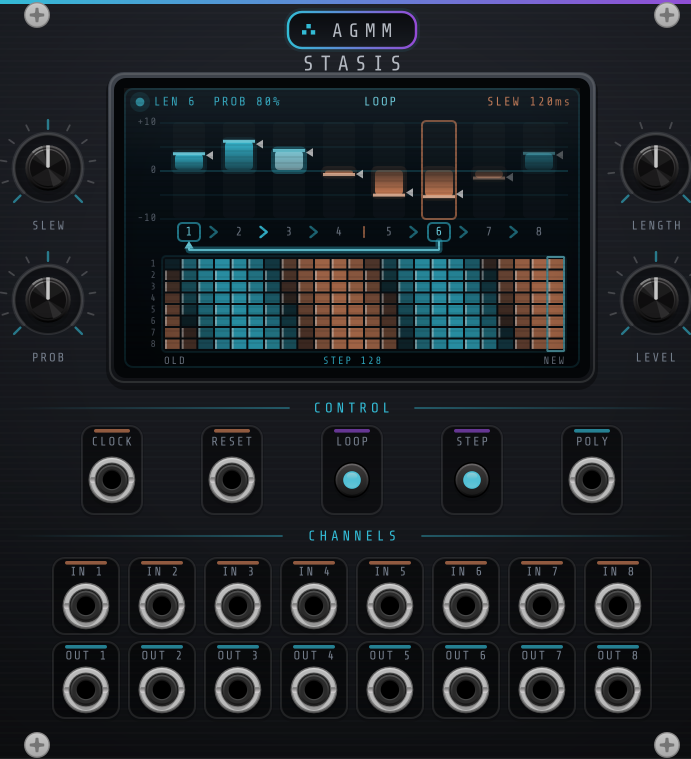

<!--
AGMM AUTOMATIC DOCUMENTATION
Source: Stasis.cpp
Generated: 2026-11-04 06:35
-->

# Stasis

## 1. Overview

The **Stasis** module is a polyphonic signal delay and memory register system designed for VCV Rack. It functions as an 8-stage signal storage system where each stage can hold a sampled voltage value, with the ability to sample inputs based on probability, loop back to previous stages, and apply slew filtering to outputs.

Key features include:
- 8 independent stages of signal storage
- Probability-based sampling (0-100%)
- Loop mode that feeds the last active stage back to the first
- Slew rate control for smooth output transitions
- Visual display showing current values, history, and system state
- Polyphonic output capability

## Module Screenshot



## 2. Architecture

### Main Classes

**`Stasis`**: The core module class inheriting from `rack::Module`. It manages all internal state, DSP processing, and handles user interactions.

**`StasisWidget`**: The visual representation of the module in the Rack UI, inheriting from `rack::ModuleWidget`. It constructs the panel layout, controls, and display elements.

### Inheritance

- `Stasis` inherits from `rack::Module`
- `StasisWidget` inherits from `rack::ModuleWidget`

### Structures

The module uses several internal data structures:

1. **State arrays**:
   - `held[ST_N]`: Current held values for each stage
   - `outv[ST_N]`: Smoothed output values for each stage
   - `flash[ST_N]`: Flash indicators for sampled stages
   - `skip[ST_N]`: Skip indicators for probability-based sampling
   - `linked[ST_N]`: Boolean indicating if input is normalled

2. **History tracking**:
   - `hist[ST_N][ST_HN]`: 24-column history buffer for each stage
   - `histUpd[ST_N][ST_HN]`: Boolean flags indicating if a stage was updated in that column
   - `histHead`, `histCount`: Circular buffer management

3. **Control state**:
   - `stepCount`: Total step count since reset
   - `vLen`, `vProb`, `vTau`: Cached parameter values for display
   - `loopOn`: Loop mode flag

### Relationships

- `StasisWidget` owns and manages the `Stasis` module instance
- The widget creates all UI elements (knobs, buttons, ports) that interact with the module
- The module processes audio samples in real-time through its `process()` method
- Visual display (`STDisplayWidget`) reads from the module's internal state for rendering

## 3. DSP Theory

### Mathematical Equations

**Slew Rate Filtering**: 
The module implements first-order low-pass filtering with a time constant τ:

$$
a = 1 - e^{-\frac{dt}{\tau}}
$$

Where:
- $ dt $ is the sample time (in seconds)
- $ \tau $ is the time constant in seconds

The filtered output is computed as:
$$
y[n] = y[n-1] + a \cdot (x[n] - y[n-1])
$$

**Probability Sampling**:
A stage is sampled with probability $ p $, where:
$$
\text{take} = \text{random\_uniform()} < p
$$

### Algorithms

1. **Clock Processing**: 
   - For each stage, determine source voltage (loop tap, noise, or previous stage)
   - Apply probability sampling to decide whether to update the held value
   - Update history buffer with current values

2. **Slew Filtering**:
   - Calculate time constant from SLEW parameter using exponential mapping
   - Apply first-order filter to smooth transitions between values

3. **Loop Mode**:
   - When enabled, stage 1 receives input from the last active stage
   - The loop connection is visualized in the display with a curved arrow

### Filters

- First-order low-pass filter for slew rate control
- Exponential mapping for time constant calculation (1ms to 2s range)

### Oscillators

- No dedicated oscillators; uses `random::uniform()` for noise generation

### Delay Lines

- Circular buffer history tracking with 24 columns per stage
- 8-stage register system with optional loop connection

### Feedback Systems

- Loop mode creates a feedback path from last stage to first stage
- Normalled inputs create chain connections between stages

### Modulation

- All parameters are modulatable via CV inputs
- SLEW, PROB, LENGTH, and LEVEL parameters can be modulated

### Random Processes

- White noise generation for stage 1 in loop mode (when not connected)
- Probability-based sampling using `random::uniform()`

## 4. Parameters and Controls

### Knobs

| Parameter | Name | Range | Default | Description |
|-----------|------|-------|---------|-------------|
| SLEW_PARAM | Slew | 0.0 - 1.0 | 0.0 | Controls output slew rate (1ms to 2s) |
| PROB_PARAM | Sample probability | 0.0 - 1.0 | 1.0 | Probability of sampling each stage (0-100%) |
| LENGTH_PARAM | Loop length | 1.0 - 8.0 | 8.0 | Number of stages in loop (snap enabled) |
| LEVEL_PARAM | Output level | -1.0 - 1.0 | 1.0 | Output voltage scaling |

### Switches

| Parameter | Name | Description |
|-----------|------|-------------|
| LOOP_PARAM | Loop | Toggles loop mode on/off |
| STEP_PARAM | Manual clock step | Triggers manual clock step |

### Buttons

- **LOOP**: Toggle button for loop mode
- **STEP**: Manual clock step button

### CV Inputs

| Input | Name | Description |
|-------|------|-------------|
| CLOCK_INPUT | Clock | Clock signal to advance stages |
| RESET_INPUT | Reset | Resets all stages and history |
| CH_INPUT + i | Channel i input | Input for stage i (normalled) |

### Gates

- No dedicated gate inputs; uses clock/reset inputs as triggers

### Enumerations

- `ParamId`: SLEW_PARAM, PROB_PARAM, LENGTH_PARAM, LEVEL_PARAM, LOOP_PARAM, STEP_PARAM
- `InputId`: CLOCK_INPUT, RESET_INPUT, CH_INPUT + 0..7
- `OutputId`: CH_OUTPUT + 0..7, POLY_OUTPUT
- `LightId`: LOOP_LIGHT, STEP_LIGHT

### Parameter Ranges

- SLEW: 0.0 - 1.0 (mapped to 1ms - 2s)
- PROB: 0.0 - 1.0 (0% - 100%)
- LENGTH: 1.0 - 8.0 (integer values, snap enabled)
- LEVEL: -1.0 - 1.0

### Default Values

- SLEW: 0.0
- PROB: 1.0
- LENGTH: 8.0
- LEVEL: 1.0

## 5. Inputs and Outputs

### Inputs

| Input | Voltage Range | Description |
|-------|---------------|-------------|
| CLOCK_INPUT | -5V to +10V | Clock signal (triggered on rising edge) |
| RESET_INPUT | -5V to +10V | Reset signal (triggered on rising edge) |
| CH_INPUT + i | -10V to +10V | Input for stage i (normalled to previous stage or noise) |

### Outputs

| Output | Voltage Range | Description |
|--------|---------------|-------------|
| CH_OUTPUT + i | -10V to +10V | Individual output for stage i |
| POLY_OUTPUT | -10V to +10V | Polyphonic output (8 channels) |

## 6. Signal Processing Pipeline

1. **Clock Detection**: Detect rising edges on clock input
2. **Manual Step**: Process manual step button press
3. **Stage Sampling**:
   - Determine source voltage for each stage
   - Apply probability sampling decision
   - Update held values if sampled
4. **History Tracking**: Store current values in history buffer
5. **Slew Filtering**: Apply first-order filter to smooth output transitions
6. **Output Generation**: Generate individual and polyphonic outputs
7. **Display Updates**: Update visual state for UI elements

## 7. Important Functions

### `doClock()`
- Processes a clock event
- Determines source voltage for each stage (loop tap, noise, or previous stage)
- Applies probability sampling to decide whether to update held values
- Updates history buffer with current values

### `process()`
- Main DSP processing function called every sample
- Handles parameter updates and control logic
- Processes clock/reset/step triggers
- Applies slew filtering to outputs
- Updates display state variables

### `doReset()`
- Resets internal state arrays
- Clears history buffers
- Resets step counter

## 8. Mathematical Implementation

### Slew Rate Calculation

```cpp
float tau = (slewK < 0.002f) ? 0.f : 0.001f * std::pow(2000.f, slewK);
float a = (tau > 0.f) ? (1.f - std::exp(-dt / tau)) : 1.f;
```

### Probability Sampling

```cpp
bool take = (prob >= 0.999f) || (random::uniform() < prob);
if (take) {
    held[i] = src;
    flash[i] = 1.f;
} else {
    skip[i] = 1.f;
}
```

### History Buffer Management

```cpp
histHead = (histHead + 1) % ST_HN;
if (histCount < ST_HN) histCount++;
```

## 9. Performance and Optimization

### CPU Usage Considerations

- Minimal computational overhead per sample
- Uses efficient first-order filtering
- Circular buffer for history tracking reduces memory operations

### Memory Allocation

- Fixed-size arrays with compile-time constants
- No dynamic allocation during processing
- Stack-based local variables

### Buffers

- History buffer: 8 stages × 24 columns = 192 floats
- Stage buffers: 8 floats each (held, outv, flash, skip, linked)

### Real-time Processing

- All operations are designed for real-time audio processing
- No blocking or time-consuming operations
- Efficient use of VCV Rack's sample-time based processing

### Thread Safety

- Module state is accessed only from the main audio thread
- No multi-threading concerns in this implementation

### Numerical Stability

- Uses standard floating-point arithmetic
- Proper handling of edge cases (zero time constants, extreme values)
- Clamp operations prevent out-of-bounds access

## 10. Dependencies

### Libraries and Headers

- `rack.hpp`: VCV Rack core library
- `dsp::SchmittTrigger`: Trigger detection utilities
- `random::uniform()`: Random number generation
- `std::pow()`, `std::exp()`, `std::round()`: Standard C++ math functions
- `std::memset()`, `std::memcpy()`: Memory operations

### External Classes

- `Module`: Base VCV Rack module class
- `ModuleWidget`: Base widget class for module UI
- `dsp::SchmittTrigger`: Trigger detection implementation
- `TransparentWidget`: Base class for custom drawing widgets
- `DarkPJ301MPort`, `RoundSmallBlackKnob`, `LEDButton`: UI components

## 11. Summary

The **Stasis** module is a sophisticated polyphonic signal memory system that implements an 8-stage register with probability-based sampling, loop mode, and slew filtering. It provides a visual display showing current values, history, and system state. The implementation uses efficient first-order filtering for smooth transitions, circular buffers for history tracking, and probability sampling to create interesting modulation patterns. The module supports both manual clock stepping and external clock inputs, with comprehensive visual feedback through its custom display widget.