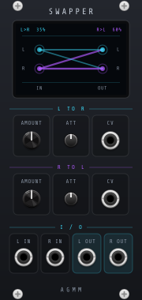

<!--
AGMM AUTOMATIC DOCUMENTATION
Source: Swapper.cpp
-->

# Swapper

## 1. Overview

`Swapper` is a 12 HP dual-channel crossfader. Left and Right inputs each have an independent "amount" control that decides how much of the *other* channel is mixed into this output:

$$
\begin{aligned}
L_{\text{out}} &= (1 - R{\to}L) \cdot L_{\text{in}} + R{\to}L \cdot R_{\text{in}} \\
R_{\text{out}} &= (1 - L{\to}R) \cdot R_{\text{in}} + L{\to}R \cdot L_{\text{in}}
\end{aligned}
$$

Each amount is `clamp(knob + attenuverter * CV, 0, 1)`, with CV scaled so 10 V = 100%. The panel display visualises both amounts as line weights in a routing diagram plus a live IN/OUT level readout.

Key features:
- Dual-channel crossfader
- Independent L→R and R→L amounts
- Per-amount CV with attenuverter
- Live routing diagram (line weight = mix amount)
- IN/OUT level readouts

## Module Screenshot

## 2. Architecture

### Main Classes

- `Swapper`: Core module class inheriting from `rack::Module`
- `SWPanel`: Static panel artwork
- `SWDisplay`: Live routing diagram

### Inheritance

- `Swapper` inherits from `rack::Module`
- Both UI widgets inherit from `rack::TransparentWidget`

### State (grouped)

| Group | Storage |
|-------|---------|
| Display | `float amtLR`, `amtRL` (current amounts) |
| Display | `float mInL, mInR, mOutL, mOutR` (peak levels) |

## 3. DSP Theory

### The crossfade

`Swapper` mixes both channels together in a symmetric way. For each output:

$$
L_{\text{out}} = L_{\text{in}} \cdot (1 - R{\to}L) + R_{\text{in}} \cdot R{\to}L
$$

$$
R_{\text{out}} = R_{\text{in}} \cdot (1 - L{\to}R) + L_{\text{in}} \cdot L{\to}R
$$

When both amounts are 0: `L_out = L_in`, `R_out = R_in` (no change).
When both amounts are 1: `L_out = R_in`, `R_out = L_in` (full swap).
When both amounts are 0.5: `L_out = (L_in + R_in)/2` (mono mix).

### Amount computation

$$
\text{amount} = \text{clamp}(\text{knob} + \text{atten} \cdot \text{CV}/10, 0, 1)
$$

The CV is divided by 10 (so 10 V = 100%) and scaled by the attenuverter (which can be negative, inverting the CV).

### Peak followers

$$
\text{peak} \leftarrow \max(|\text{signal}|, \text{peak} \cdot (1 - 5\Delta t))
$$

This gives a ~200 ms decay, which looks good on the display.

## 4. Parameters and Controls

### Knobs

| Parameter | Min | Max | Default | Description |
|-----------|-----|-----|---------|-------------|
| `LTO_R_KNOB` | 0 | 1 | 0 | L to R amount |
| `RTO_L_KNOB` | 0 | 1 | 0 | R to L amount |
| `LTO_R_ATTEN` | −1 | 1 | 0 | L to R CV attenuverter |
| `RTO_L_ATTEN` | −1 | 1 | 0 | R to L CV attenuverter |

### Inputs

| Input | Description |
|-------|-------------|
| `L_IN` | Left input |
| `R_IN` | Right input |
| `CV_LTOR` | CV for L to R (10 V = 100%) |
| `CV_RTOL` | CV for R to L (10 V = 100%) |

### Outputs

| Output | Description |
|--------|-------------|
| `L_OUT` | Left output |
| `R_OUT` | Right output |

### Enumerations

- `ParamId`: LtoRKnob, RtoLKnob, LtoRAtten, RtoLAtten
- `InputId`: LIn, RIn, CVLtoR, CVRtoL
- `OutputId`: LOut, ROut

## 5. Inputs and Outputs

### Inputs

| Name | Type | Range | Description |
|------|------|-------|-------------|
| `L_IN` | Audio | ±10 V | Left audio |
| `R_IN` | Audio | ±10 V | Right audio |
| `CV_LTOR` | CV | 0–10 V | L→R amount CV |
| `CV_RTOL` | CV | 0–10 V | R→L amount CV |

### Outputs

| Name | Type | Range | Description |
|------|------|-------|-------------|
| `L_OUT` | Audio | ±10 V | Left output |
| `R_OUT` | Audio | ±10 V | Right output |

### Bypass

`configBypass(L_IN, L_OUT)` and `configBypass(R_IN, R_OUT)`.

## 6. Signal Processing Pipeline

1. **Read inputs** — L and R.
2. **Read knobs + CVs + attens**.
3. **Compute amounts** — `ltoR_amount`, `rtoL_amount`.
4. **Crossfade** — Compute L_out and R_out.
5. **Write outputs**.
6. **Update display** — Peak followers.

## 7. Important Functions

### `process(const ProcessArgs &args)`

The main callback described in §6.

## 8. Mathematical Implementation

### Amounts

$$
\text{amount} = \text{clamp}(\text{knob} + \text{atten} \cdot \text{CV}/10, 0, 1)
$$

### Crossfade

$$
L_{\text{out}} = L_{\text{in}}(1 - \text{rtoL}) + R_{\text{in}} \cdot \text{rtoL}
$$

$$
R_{\text{out}} = R_{\text{in}}(1 - \text{ltoR}) + L_{\text{in}} \cdot \text{ltoR}
$$

### Peak follower

$$
\text{peak} \leftarrow \max(|\text{signal}|, \text{peak} \cdot (1 - 5\Delta t))
$$

## 9. Performance and Optimization

### CPU Usage

- 2 multiplies per output + 2 adds ≈ 8 flops
- Peak followers ≈ 8 flops
- Total: ~20 flops/sample

### Memory Allocation

- No allocation ever
- Fixed-size state

### Buffers

- 4 floats for the display amounts and meters

### Real-time Processing

- O(1) per sample
- No allocation, no blocking

### Thread Safety

- All state written by audio thread, read by UI thread via torn reads

### Numerical Stability

- Amounts clamped to `[0, 1]`
- Inputs bounded by ±10 V
- No feedback, no accumulation

## 10. Dependencies

### Libraries/Headers

- `plugin.hpp` — VCV Rack core
- `agmm_ui.hpp` — shared AGMM UI helpers
- `<cmath>`, `<cstdio>`, `<cstring>`, `<algorithm>`

### External Classes

- `rack::Module`, `rack::TransparentWidget`, `rack::engine::ParamQuantity`
- `agmm::panelBase`, `agmm::bezel`, `agmm::cell`, `agmm::text`, `agmm::screen`, `agmm::sectionHeader`, `agmm::withA`, `agmm::violet`, `agmm::accent`, `agmm::bright`, `agmm::warm`, `agmm::dim`, `agmm::ALIGN_L/C/R`

## 11. Summary

`Swapper` is a dual-channel crossfader with a live routing diagram. At amount = 0, it passes each channel through unchanged; at amount = 1, it fully swaps them; at amount = 0.5, it mono-mixes them. It's useful for stereo manipulation, for fading between two signal paths, or for creating a "stereo flip" effect that can be modulated.

The **display** is the standout feature: the routing diagram shows the four links (L→L, R→L, R→R, L→R) with line weight proportional to the mix amount. You can see at a glance how much cross-feed is happening in each direction.

The main limitations are: no smoothing on the CV (fast CV changes cause clicks), and no master gain. But for a simple utility, this is exactly right.