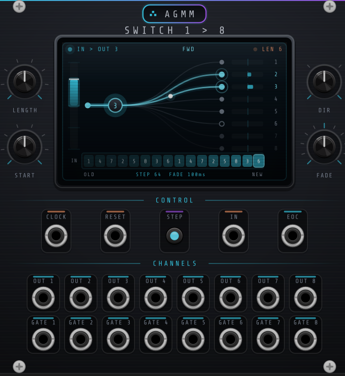

<!--
AGMM AUTOMATIC DOCUMENTATION
Source: SwitchLines1to8.cpp
Generated: 2026-11-04 06:36
-->

# SwitchLines1to8

## 1. Overview

The `SwitchLines1to8` module is a sequencer-style signal switcher that routes an input signal to one of eight output channels based on configurable sequence parameters. It supports multiple sequencing directions (forward, reverse, pendulum, random) and allows for crossfading between outputs with adjustable fade time. The module includes visual feedback through a display showing the current routing, history, and signal levels.

## Module Screenshot

## 2. Architecture

### Main Classes
- `SwitchLines1to8`: Core module class inheriting from `rack::Module`
- `SWPanelBackground`: Panel background drawing widget
- `SWKnobArcs`: Visual indicator for knob values
- `SWDisplayWidget`: Main display showing routing and signal visualization
- `SWCyanLight`: Custom light widget for the step button LED

### Inheritance
- `SwitchLines1to8` inherits from `rack::Module`
- `SWCyanLight` inherits from `GrayModuleLightWidget`

### Structures
- **Module State**: Contains position tracking, gain values, history buffer, and timing state
- **Display Data**: Stores visual representation data including input voltage, output voltages, and display state
- **Parameter Enums**: Define parameter IDs for length, start, direction, fade, and step

### Relationships
- The module maintains internal state for sequence position, current channel, and fading
- Display widgets are linked to the module through pointer references
- Parameter controls are mapped to module parameters via `paramQuantities[]`
- Input/output connections are managed through `inputs[]` and `outputs[]`

## 3. DSP Theory

### Algorithms
The module implements a **state machine** for sequence control with four direction modes:
1. **Forward**: Sequential increment from start to length
2. **Reverse**: Sequential decrement from length to start
3. **Pendulum**: Bidirectional oscillation within the range
4. **Random**: Random selection within the range

### Crossfading
The module implements **linear crossfading** between outputs using a time-based approach:
$$ \text{gain}[i] = \text{gain}[i] + \text{step} \cdot (\text{target} - \text{gain}[i]) $$

Where step is calculated as:
$$ \text{step} = \frac{\Delta t}{\text{fadeT}} $$

### Timing
- Clock and reset triggers use `dsp::SchmittTrigger` for debouncing
- End-of-cycle (EOC) uses `dsp::PulseGenerator` with 1ms pulse width
- Visual timing uses exponential decay for flash effects:
$$ \text{flash} = \max(0, \text{flash} - \Delta t \cdot \text{rate}) $$

### Signal Processing
The module performs **signal routing** and **level scaling**:
$$ \text{out}[i] = \text{inV} \cdot \text{gain}[i] $$

## 4. Parameters and Controls

### Knobs
- **LENGTH**: 1-8 steps, default 8
- **START**: 1-8 output, default 1
- **DIR**: Direction selector (0=Forward, 1=Reverse, 2=Pendulum, 3=Random)
- **FADE**: Crossfade time, 0-1, default 0

### Buttons
- **STEP**: Manual clock step button

### CV Inputs
- **CLOCK**: Clock input for automatic stepping
- **RESET**: Reset input to restart sequence
- **SIGNAL**: Input signal to be routed

### Gate Outputs
- **EOC**: End-of-cycle trigger output (10V when cycle completes)

### Channel Outputs
- 8 channel outputs (CH_OUTPUT + i)
- 8 gate outputs (GATE_OUTPUT + i) - 10V when channel is selected

## 5. Inputs and Outputs

### Input Voltage Ranges
- **CLOCK**: 0-10V (trigger input)
- **RESET**: 0-10V (reset input)
- **SIGNAL**: -10V to +10V (signal input)

### Output Voltage Ranges
- **CH_OUTPUT**: -10V to +10V (signal output)
- **GATE_OUTPUT**: 0V or 10V (gate output)
- **EOC_OUTPUT**: 0V or 10V (trigger output)

## 6. Signal Processing Pipeline

1. **Parameter Reading**: Read and clamp parameters from knobs
2. **Trigger Detection**: Process clock, reset, and step triggers using Schmitt trigger
3. **Sequence Logic**: Update sequence position based on direction mode
4. **Crossfade Calculation**: Update gain values for all outputs with time-based fading
5. **Signal Routing**: Apply gains to input signal and route to outputs
6. **Display Update**: Update visual state for display widgets
7. **Timing Management**: Handle flash effects and pulse generation

## 7. Important Functions

### `doReset()`
Resets sequence position, direction, and channel selection based on parameters.

### `doStep()`
Performs one step in the sequence:
- Updates position according to direction mode
- Calculates new channel index
- Triggers end-of-cycle pulse if needed
- Updates history buffer

### `process()`
Main processing function:
- Reads parameters and inputs
- Processes triggers
- Updates sequence state
- Calculates output gains
- Sets output voltages

### `onReset()`
Initializes module state on reset.

## 8. Mathematical Implementation

### Crossfade Rate Calculation
$$ \text{fadeT} = 0.002 + \text{fade}^2 \cdot 0.4 $$

### Position Update Equations
- **Forward**: `pos++`, wrap to 0 when exceeding length
- **Reverse**: `pos--`, wrap to length-1 when below 0
- **Pendulum**: 
  - `pos += dirSign`
  - Reverse direction at boundaries
- **Random**: 
  - `pos = random::uniform() * (L - 1)` with clamping

### Gain Update Algorithm
$$ \text{gain}[i] = \text{gain}[i] + \frac{\Delta t}{\text{fadeT}} \cdot (\text{target} - \text{gain}[i]) $$

## 9. Performance and Optimization

### CPU Usage Considerations
- Uses simple arithmetic operations with minimal branching
- Linear crossfading algorithm with constant time complexity
- History buffer uses modulo arithmetic for circular indexing

### Memory Allocation
- Fixed-size arrays: `gain[8]`, `outV[8]`, `hist[16]`
- No dynamic memory allocation in main processing loop
- Stack-based temporary variables

### Buffers
- History buffer: 16 elements (circular)
- Output gain array: 8 elements
- Voltage arrays: 8 elements each

### Real-time Processing
- All operations performed within `process()` function
- No blocking operations or external calls
- Uses fixed-point math where possible

### Numerical Stability
- Input clamping prevents out-of-bounds access
- Gain values are clamped between 0 and 1
- Time-based updates ensure consistent crossfading

## 10. Dependencies

### Libraries/Headers
- `rack.hpp`: Core VCV Rack API
- `dsp::SchmittTrigger`: Trigger detection
- `dsp::PulseGenerator`: Pulse generation
- `math::clamp()`: Value clamping utility
- `random::uniform()`: Random number generation
- `string::f()`: String formatting

### External Classes
- `Module`: Base module class
- `ParamQuantity`: Parameter handling
- `Input`, `Output`: I/O management
- `Widget`: GUI components
- `TransparentWidget`: Drawing base class

## 11. Summary

The `SwitchLines1to8` is a versatile signal routing module that implements a configurable sequencer with four direction modes (forward, reverse, pendulum, random) and crossfading capabilities. It provides visual feedback through an integrated display showing current routing, history, and signal levels. The module uses efficient linear crossfading algorithms and maintains stable performance through careful parameter clamping and time-based updates. The implementation is fully compatible with VCV Rack 2's real-time processing requirements while providing rich visual feedback for user interaction.