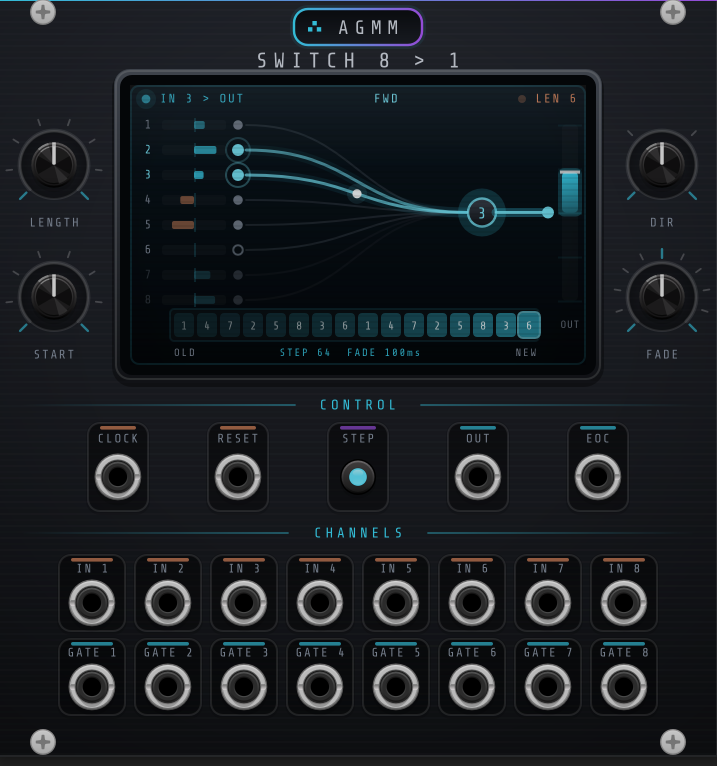

<!--
AGMM AUTOMATIC DOCUMENTATION
Source: SwitchLines8to1.cpp
Generated: 2026-11-04 06:37
-->

# SwitchLines8to1

## 1. Overview

The `SwitchLines8to1` module is a multi-channel switch matrix that selects one of eight input signals to route to a single output. It features sequenced switching with configurable direction, length, and crossfade behavior. The module supports both automatic clocked stepping and manual step triggering, with visual feedback showing the current selection, history, and signal levels.

## Module Screenshot

## 2. Architecture

### Main Classes
- **`SwitchLines8to1`**: Core module class inheriting from `rack::Module`
- **`SwitchLines8to1Widget`**: UI widget class inheriting from `rack::ModuleWidget`
- **Anonymous namespace helpers**: Drawing utilities and custom widgets

### Inheritance
- `SwitchLines8to1` inherits from `rack::Module`
- `SwitchLines8to1Widget` inherits from `rack::ModuleWidget`

### Structures
- **Parameter IDs**: Enumerated parameters for LENGTH, START, DIR, FADE, STEP
- **Input IDs**: Clock, Reset, 8 channel inputs (CH_INPUT + i)
- **Output IDs**: Single output, End-of-cycle trigger, 8 gate outputs (GATE_OUTPUT + i)
- **Light IDs**: Step light indicator

### Relationships
- `SwitchLines8to1Widget` owns and manages:
  - `SWPanelBackground`
  - `SWKnobArcs`
  - `SWDisplayWidget`
  - All controls (knobs, buttons, ports)
- `SwitchLines8to1` maintains state for:
  - Sequencer position and direction
  - Crossfade progress
  - Input voltage history
  - Trigger generators

## 3. DSP Theory

### Algorithms
- **Sequencer Logic**: Implements four switching directions:
  - Forward (linear)
  - Reverse (linear)
  - Pendulum (bidirectional)
  - Random (uniform distribution)

### Mathematical Equations
Crossfade progression:
$$
xf_{n+1} = \min(1.0, xf_n + \frac{\Delta t}{\tau})
$$

Where $\tau$ is the fade time constant calculated as:
$$
\tau = 0.002 + \text{FADE}^2 \times 0.4
$$

### Filters
None explicitly implemented.

### Oscillators
None explicitly implemented.

### Delay Lines
- History buffer: 16-element circular buffer storing past channel selections
- Input voltage history for display purposes

### Feedback Systems
- Crossfade feedback from previous to current input
- Clock and reset trigger detection using Schmitt triggers

### Modulation
- Parameters modulated via CV inputs (LENGTH, START, DIR, FADE)
- Manual step button triggers sequencing

### Random Processes
- Random direction uses uniform distribution over [0, L-1] where L is sequence length
- Excludes current position from selection to avoid staying on same input

## 4. Parameters and Controls

### Knobs
- **LENGTH**: 1-8 steps (default: 8)
- **START**: 1-8 input (default: 1)
- **DIR**: Direction selector (0=Forward, 1=Reverse, 2=Pendulum, 3=Random)
- **FADE**: Crossfade time (0-1, default: 0)

### Buttons
- **STEP**: Manual clock step button

### CV Inputs
- **CLOCK**: Clock input for automatic stepping
- **RESET**: Reset input to restart sequence
- **CH_INPUT + i**: 8 channel inputs (i = 0..7)

### Gates
- **GATE_OUTPUT + i**: 8 gate outputs, active when corresponding input is selected

### Enumerations
- `DIR_PARAM`: Direction enum {Forward, Reverse, Pendulum, Random}

### Parameter Ranges and Defaults
- LENGTH: 1-8 steps, default 8
- START: 1-8 inputs, default 1
- DIR: 0-3, default 0 (Forward)
- FADE: 0.0-1.0, default 0.0
- STEP: Button (no CV control)

## 5. Inputs and Outputs

### Inputs
- **CLOCK_INPUT**: Clock signal (0.1V threshold)
- **RESET_INPUT**: Reset signal (0.1V threshold)
- **CH_INPUT + i**: 8 channel inputs, voltage range ±10V
- **(CV inputs)**: Parameters modulated via CV

### Outputs
- **OUT_OUTPUT**: Selected input signal, voltage range ±10V
- **EOC_OUTPUT**: End-of-cycle trigger pulse (10V)
- **GATE_OUTPUT + i**: 8 gate outputs, 10V when corresponding input selected

## 6. Signal Processing Pipeline

1. **Parameter Processing**: Read and clamp parameter values
2. **Trigger Detection**: Process clock and reset inputs using Schmitt triggers
3. **Step Logic**: Execute step function based on trigger or manual button press
4. **Crossfade Calculation**: Update crossfade progress over time
5. **Signal Routing**: Select current input and apply crossfade to output voltage
6. **Gate Generation**: Set gate outputs for currently selected channel
7. **Trigger Generation**: Generate end-of-cycle pulse when sequence completes
8. **Display Updates**: Update history buffer and visual state

## 7. Important Functions

### `doReset()`
Resets sequencer position, direction, and clears crossfade state.

### `doStep()`
Executes one step in the sequence based on current direction mode:
- Forward: Increment position
- Reverse: Decrement position
- Pendulum: Bidirectional stepping with boundary reversal
- Random: Uniform random selection excluding current position

### `process()`
Main processing function that:
- Reads parameters and inputs
- Handles trigger detection
- Updates sequencer state
- Calculates crossfade progression
- Routes signals to outputs

## 8. Mathematical Implementation

### Crossfade Time Calculation
$$
\tau = 0.002 + \text{FADE}^2 \times 0.4
$$

### Crossfade Progress Update
$$
xf_{n+1} = \min(1.0, xf_n + \frac{\Delta t}{\tau})
$$

### Random Selection
For random direction:
$$
\text{new\_pos} = \text{clamp}(\text{random\_uniform}(0, L-1), 0, L-1)
$$
Where new_pos ≠ current position.

## 9. Performance and Optimization

### CPU Usage Considerations
- Minimal computational overhead
- Efficient parameter clamping and validation
- Simple arithmetic operations only

### Memory Allocation
- Static buffers for history (16 elements)
- No dynamic allocation in main processing loop

### Buffers
- Circular history buffer of 16 integers
- Input voltage array of 8 floats
- Display state arrays for rendering

### Real-time Processing
- All operations performed within real-time constraints
- No blocking operations or heavy computations

### Thread Safety
- Single-threaded operation (main audio thread)
- No concurrent access to module state

### Numerical Stability
- Parameter clamping prevents out-of-bounds access
- Proper handling of floating-point arithmetic
- Clamp values to valid ranges before processing

## 10. Dependencies

### Libraries and Headers
- `rack.hpp`: VCV Rack core library
- `dsp::SchmittTrigger`: Trigger detection utilities
- `dsp::PulseGenerator`: Pulse generation for EOC output
- `string::f`: String formatting utilities
- `random::uniform()`: Random number generation
- `math::clamp()`: Value clamping utilities

### External Classes
- `Module`, `ModuleWidget`: Base VCV Rack classes
- `ParamQuantity`, `Input`, `Output`, `Light`: VCV Rack I/O management
- `TransparentWidget`, `DrawArgs`: UI drawing infrastructure

## 11. Summary

The `SwitchLines8to1` module implements a sophisticated 8-to-1 switch matrix with sequenced switching capabilities. It provides four distinct direction modes (forward, reverse, pendulum, random) with configurable sequence length and start position. The module features smooth crossfading between inputs, visual feedback through an integrated display showing input levels, current selection, history, and control status. The design emphasizes real-time performance with minimal CPU usage while providing rich modulation capabilities through CV inputs and manual controls.