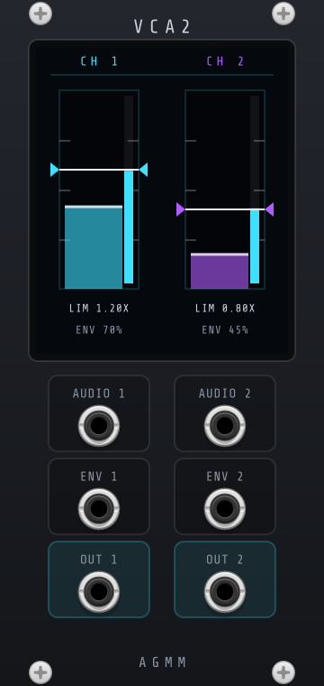

<!--
AGMM AUTOMATIC DOCUMENTATION
Source: VCA2.cpp
-->

# VCA2

## 1. Overview

`VCA2` is a 12 HP dual VCA with a per-channel gain-limit knob. Each channel has an audio input, an envelope CV input (0–10 V), and a gain-limit knob (0×..2×). The display shows two vertical "limit bars" that double as interactive controls (click/drag to set the limit, double-click to reset to 1×) and as envelope meters.

Key features:
- 2 independent VCA channels
- Per-channel envelope CV input (unpatched = unity gain)
- Per-channel gain-limit knob (0×..2×)
- Interactive limit bars (click/drag to set, double-click to reset)
- Live output peak meter (thin violet line)
- CV-able VCA with no distortion (linear)
- Bypass when unpatched

## Module Screenshot

## 2. Architecture

### Main Classes

- `VCA2`: Core module class inheriting from `rack::Module`
- `V2Panel`: Static panel artwork
- `V2Display`: Static display background (channel captions)
- `V2Bar`: Interactive vertical limit bar

### Inheritance

- `VCA2` inherits from `rack::Module`
- All UI widgets inherit from `rack::TransparentWidget`

### State (grouped)

| Group | Storage |
|-------|---------|
| Display | `float barFillPercent[2]`, `float outPeak[2]`, `bool envConn[2]` |

## 3. DSP Theory

### Per-channel gain

If the ENV input is patched:

$$
g = \text{clamp}(\text{env}/10, 0, 1) \cdot \text{limit}
$$

$$
\text{out} = \text{in} \cdot g
$$

If the ENV input is NOT patched:

$$
\text{out} = \text{in}
$$

(unity gain, full bar).

### Bar fill

The bar fill is calculated relative to the limit:

$$
\text{fill} = \frac{\text{env}}{\text{limit} \cdot 10}
$$

clamped to `[0, 1]`. So when env = limit*10, the bar is full.

### Output peak meter

A slow-decay peak follower:

$$
\text{peak} \leftarrow \max(|\text{out}|, \text{peak} \cdot (1 - 5\Delta t))
$$

### Interactive limit bar

The `V2Bar` widget converts vertical drag position to a limit value:

$$
\text{limit} = \left(1 - \frac{y}{H}\right) \cdot 2
$$

So y = 0 (top) → limit = 2, y = H (bottom) → limit = 0.

Double-click resets to 1.

## 4. Parameters and Controls

### Knobs

| Parameter | Min | Max | Default | Description |
|-----------|-----|-----|---------|-------------|
| `PARAM_LIMIT1` | 0 | 2 | 1 | Channel 1 gain limit |
| `PARAM_LIMIT2` | 0 | 2 | 1 | Channel 2 gain limit |

### Inputs

| Input | Description |
|-------|-------------|
| `INPUT_AUDIO1` | Channel 1 audio |
| `INPUT_AUDIO2` | Channel 2 audio |
| `INPUT_ENV1` | Channel 1 envelope CV |
| `INPUT_ENV2` | Channel 2 envelope CV |

### Outputs

| Output | Description |
|--------|-------------|
| `OUTPUT_1` | Channel 1 |
| `OUTPUT_2` | Channel 2 |

### Enumerations

- `ParamId`: Limit1, Limit2
- `InputId`: Audio1, Audio2, Env1, Env2
- `OutputId`: Out1, Out2

## 5. Inputs and Outputs

### Inputs

| Name | Type | Range | Description |
|------|------|-------|-------------|
| `INPUT_AUDIO1` | Audio | ±10 V | Channel 1 audio |
| `INPUT_AUDIO2` | Audio | ±10 V | Channel 2 audio |
| `INPUT_ENV1` | CV | 0–10 V | Channel 1 envelope |
| `INPUT_ENV2` | CV | 0–10 V | Channel 2 envelope |

### Outputs

| Name | Type | Range | Description |
|------|------|-------|-------------|
| `OUTPUT_1` | Audio | ±10 V | Channel 1 |
| `OUTPUT_2` | Audio | ±10 V | Channel 2 |

### Bypass

`configBypass(INPUT_AUDIO1, OUTPUT_1)` and `configBypass(INPUT_AUDIO2, OUTPUT_2)`.

## 6. Signal Processing Pipeline

1. **For each channel**:
   - Read audio input.
   - Check if ENV is connected.
   - If connected: compute `g = clamp(env/10, 0, 1) * limit`, `out = in * g`, `fill = env/(limit*10)`.
   - If not connected: `out = in`, `fill = 1`.
   - Write output.
   - Update peak follower.

## 7. Important Functions

### `process(const ProcessArgs &args)`

The main callback described in §6.

### `V2Bar::apply()`

Converts `dragY` to a limit value and writes it to the module.

### `V2Bar::drawLayer(NVGcontext *vg, int layer)`

Draws the interactive bar.

## 8. Mathematical Implementation

### Gain

$$
g = \text{clamp}(\text{env}/10, 0, 1) \cdot \text{limit}
$$

### Output

$$
\text{out} = \text{in} \cdot g
$$

### Bar fill

$$
\text{fill} = \text{clamp}\left(\frac{\text{env}}{\text{limit} \cdot 10}, 0, 1\right)
$$

### Peak follower

$$
\text{peak} \leftarrow \max(|\text{out}|, \text{peak} \cdot (1 - 5\Delta t))
$$

### Interactive limit

$$
\text{limit} = (1 - y/H) \cdot 2
$$

## 9. Performance and Optimization

### CPU Usage

- Per sample: 2 channels × (read + conditional + write) ≈ 20 flops
- Total: ~20 flops/sample

### Memory Allocation

- No allocation ever
- Fixed-size state

### Buffers

- 2 × 3 floats for the display state

### Real-time Processing

- O(1) per channel
- No allocation, no blocking

### Thread Safety

- All state written by audio thread, read by UI thread via torn reads
- The interactive bar writes to `params[PARAM_LIMIT]` from the UI thread (which is a data race with the audio thread, but Rack's parameters are `std::atomic`-like)

### Numerical Stability

- Gain clamped to `[0, 1]`
- `limit` clamped to `[0, 2]`
- No feedback, no accumulation

## 10. Dependencies

### Libraries/Headers

- `plugin.hpp` — VCV Rack core
- `agmm_ui.hpp` — shared AGMM UI helpers
- `<cmath>`, `<cstdio>`, `<cstring>`, `<algorithm>`

### External Classes

- `rack::Module`, `rack::TransparentWidget`, `rack::engine::ParamQuantity`
- `agmm::panelBase`, `agmm::bezel`, `agmm::cell`, `agmm::plate`, `agmm::text`, `agmm::screen`, `agmm::plotFrame`, `agmm::sectionHeader`, `agmm::meter`, `agmm::withA`, `agmm::violet`, `agmm::accent`, `agmm::bright`, `agmm::warm`, `agmm::dim`, `agmm::ALIGN_L/C/R`

## 11. Summary

`VCA2` is a simple dual VCA with a twist: the gain limit is adjustable, and the limit bars are interactive. This is useful for patches where you want a VCA that can't go above a certain level (e.g., to protect downstream modules or to limit the dynamic range of a modulation source).

The **interactive bars** are the standout feature: instead of a knob, you drag directly on the display to set the limit, and double-click to reset. This is faster and more intuitive than a knob for this particular parameter.

The main limitations are: no CV input for the limit (only manual), and no smoothing on the limit (so fast drags cause zipper noise). But for a simple utility VCA, this is excellent.