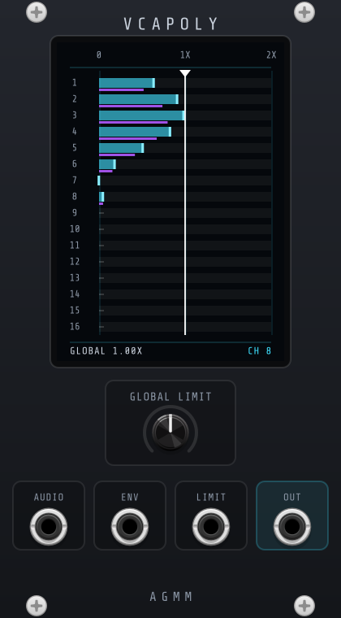

<!--
AGMM AUTOMATIC DOCUMENTATION
Source: VCAPoly.cpp
-->

# VCAPoly

## 1. Overview

`VCAPoly` is a 14 HP polyphonic VCA with a global limit. It has a polyphonic audio input (up to 16 voices), a polyphonic envelope CV input, and a global limit knob. If the ENV input is unpatched, all voices pass through at unity gain. If the LIMIT CV input is patched, the limit can be set per-voice.

Key features:
- Polyphonic VCA (up to 16 voices)
- Per-voice envelope CV (0–10 V)
- Global limit (0×..2×)
- Per-voice limit CV (optional)
- 16 stacked voice rows in display, with gain bar, peak tick, and limit marker
- Unity gain when ENV is unpatched
- Bypass when unpatched

## Module Screenshot

## 2. Architecture

### Main Classes

- `VCAPoly`: Core module class inheriting from `rack::Module`
- `VPPanel`: Static panel artwork
- `VPKnobArc`: Live value arc around the limit knob
- `VPDisplay`: Live voice display

### Inheritance

- `VCAPoly` inherits from `rack::Module`
- All UI widgets inherit from `rack::TransparentWidget`

### State (grouped)

| Group | Storage |
|-------|---------|
| Display | `float envelopeFill[16]`, `gainNow[16]`, `outPeak[16]`, `int activeCh`, `bool envConn`, `bool limitCvConn` |

## 3. DSP Theory

### Per-voice gain

For each voice `c`:

If ENV not connected:

$$
g_c = 1, \quad \text{out}_c = \text{in}_c, \quad \text{fill}_c = 1
$$

If ENV connected:

$$
g_c = \text{clamp}(\text{env}_c / 10, 0, 1) \cdot \text{limit}_c
$$

$$
\text{out}_c = \text{in}_c \cdot g_c
$$

$$
\text{fill}_c = \text{clamp}\left(\frac{\text{env}_c}{\text{limit}_c \cdot 10}, 0, 1\right)
$$

### Limit

- If LIMIT CV not connected: `limit = global knob`
- If LIMIT CV connected: `limit_c = clamp(CV_c / 10, 0, 2)`

### Channel count

The output channel count follows the audio input's channel count. If no audio is connected, output 0 channels.

### Peak follower

$$
\text{peak}_c \leftarrow \max(|\text{out}_c|, \text{peak}_c \cdot (1 - 5\Delta t))
$$

## 4. Parameters and Controls

### Knobs

| Parameter | Min | Max | Default | Description |
|-----------|-----|-----|---------|-------------|
| `PARAM_LIMIT` | 0 | 2 | 1 | Global gain limit |

### Inputs

| Input | Description |
|-------|-------------|
| `INPUT_AUDIO` | Polyphonic audio |
| `INPUT_ENV` | Polyphonic envelope CV |
| `INPUT_LIMIT_CV` | Polyphonic limit CV |

### Outputs

| Output | Description |
|--------|-------------|
| `OUTPUT_AUDIO` | Polyphonic output |

### Enumerations

- `ParamId`: Limit
- `InputId`: Audio, Env, LimitCV
- `OutputId`: AudioOut

## 5. Inputs and Outputs

### Inputs

| Name | Type | Range | Description |
|------|------|-------|-------------|
| `INPUT_AUDIO` | Poly Audio | ±10 V | Polyphonic audio |
| `INPUT_ENV` | Poly CV | 0–10 V | Polyphonic envelope |
| `INPUT_LIMIT_CV` | Poly CV | 0–10 V | Polyphonic limit |

### Output

| Name | Type | Range | Description |
|------|------|-------|-------------|
| `OUTPUT_AUDIO` | Poly Audio | ±10 V | Polyphonic output |

### Bypass

`configBypass(INPUT_AUDIO, OUTPUT_AUDIO)`.

## 6. Signal Processing Pipeline

1. **Read audio channel count**.
2. **If 0 channels**: output 0, clear all display state, return.
3. **Check ENV and LIMIT CV connections**.
4. **For each voice**:
   - Read audio, env (or 0), limit (or global knob).
   - Compute gain and fill.
   - Write output.
   - Update peak.
5. **Clear display state** for voices beyond the active count.

## 7. Important Functions

### `process(const ProcessArgs &args)`

The main callback described in §6.

## 8. Mathematical Implementation

### Gain

$$
g = \text{clamp}(\text{env}/10, 0, 1) \cdot \text{limit}
$$

### Fill

$$
\text{fill} = \text{clamp}\left(\frac{\text{env}}{\text{limit} \cdot 10}, 0, 1\right)
$$

### Peak

$$
\text{peak} \leftarrow \max(|\text{out}|, \text{peak} \cdot (1 - 5\Delta t))
$$

## 9. Performance and Optimization

### CPU Usage

- Per sample: 16 voices × (read + conditional + write + peak) ≈ 100 flops
- Total: ~100 flops/sample

### Memory Allocation

- No allocation ever
- Fixed-size state

### Buffers

- `envelopeFill[16]`, `gainNow[16]`, `outPeak[16]`: 48 floats

### Real-time Processing

- Loop bounded by 16
- No allocation, no blocking

### Thread Safety

- All state written by audio thread, read by UI thread via torn reads

### Numerical Stability

- Gain clamped to `[0, 1]`
- `limit` clamped to `[0, 2]`
- No feedback, no accumulation

## 10. Dependencies

### Libraries/Headers

- `plugin.hpp` — VCV Rack core
- `agmm_ui.hpp` — shared AGMM UI helpers
- `<cmath>`, `<cstdio>`, `<cstring>`, `<algorithm>`

### External Classes

- `rack::Module`, `rack::TransparentWidget`, `rack::engine::ParamQuantity`
- `agmm::panelBase`, `agmm::bezel`, `agmm::cell`, `agmm::plate`, `agmm::text`, `agmm::screen`, `agmm::plotFrame`, `agmm::sectionHeader`, `agmm::meter`, `agmm::withA`, `agmm::violet`, `agmm::accent`, `agmm::bright`, `agmm::warm`, `agmm::dim`, `agmm::ALIGN_L/C/R`

## 11. Summary

`VCAPoly` is the polyphonic version of `VCA2`. It has a polyphonic audio input, a polyphonic envelope CV, and a global limit knob. If the LIMIT CV input is patched, the limit can be set per-voice.

The **display** is the standout feature: 16 stacked voice rows, each with a gain bar, a peak tick, and a limit marker. This makes it easy to see what's happening across all voices — which voice is loud, which voice is saturated, etc.

The main limitation is that the limit is global by default (one knob for all voices). For per-voice limits, patch the LIMIT CV input. This is a reasonable design choice for a compact module, but it does limit the flexibility.

For a stereo mixer with VCAs, chain with `Mixer3` or `Mixer6`. For a single-voice VCA with more features, use `VCA2`. For polyphonic VCA with more control, use `Bastion` (which can be a VCA via the LP output).