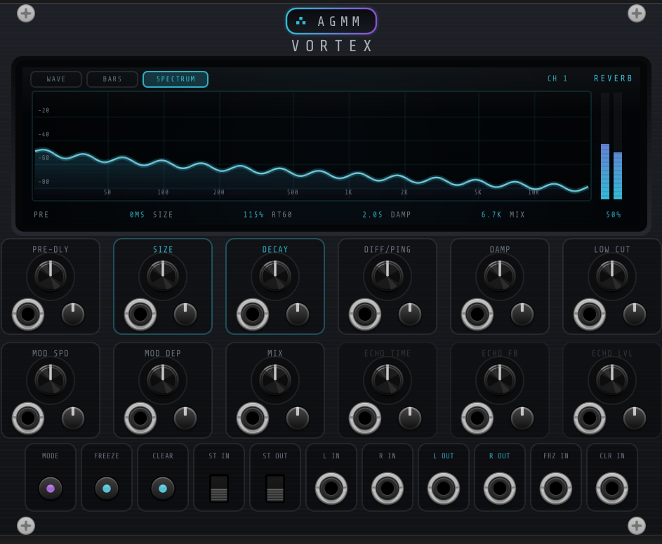

# Vortex — Reverb / Echo Module for VCV Rack

Vortex is a 32 HP stereo reverb and echo module for VCV Rack. It combines a plate-style reverb engine with a tempo-friendly echo mode, switchable per-voice, with a built-in oscilloscope, tap analyser, and spectrum display.

## Module Screenshot

---

## Features at a glance

- Two engines in one module: **plate reverb** and **ping-pong echo**, toggled with the MODE button.
- **12 CV-controllable parameters**, each with its own attenuverter and CV input jack.
- **Polyphonic** (up to the engine's channel limit) with optional stereo input and stereo output modes.
- **Freeze** (latching button + gate input) to hold the tail indefinitely.
- **Clear** button/trigger with a smooth wet-signal fade so you don't get clicks.
- **Three display modes** — WAVE, BARS, SPECTRUM — with clickable tabs and a context menu.
- **Output safety limiter** clamps to ±12 V and mutes briefly if a NaN or runaway value appears.
- **Patch-persistent state**: CV range, display mode, freeze latch, and echo mode are saved with the patch.

---

## Panel layout

### Display (top)

A 440 × 112 px screen with three tabs and a plot area.

| Tab | What it shows |
|-----|---------------|
| **WAVE** | Scrolling min/max envelope of the L output (cyan), R output (violet), and the dry input (white). ~4 seconds of history. |
| **BARS** | Reverb mode: level of the 14 plate output taps (7 L + 7 R) with their delay times in ms. Echo mode: predicted level of each repeat (0 to −60 dB) with repeat times in seconds. |
| **SPECTRUM** | Log-frequency FFT (4096-point, Hann window) of the summed output, 20 Hz – 20 kHz, with peak-hold trace. |

- Click a tab to select it, or click anywhere in the plot to cycle modes.
- The header shows the current engine (REVERB / ECHO), freeze and stereo status, and channel count.
- The footer shows five live readouts for the current mode.
- Two thin stereo meters sit to the right of the plot.
- During a Clear operation the plot flashes violet until the fade completes.

### Control grid (middle)

Twelve identical cells, each with a knob, a CV input jack (left), and a bipolar attenuverter (right).

| Row 1 | Row 2 |
|-------|-------|
| PRE-DLY | MOD SPD |
| SIZE | MOD DEP |
| DECAY | MIX |
| DIFF/PING | ECHO TIME |
| DAMP | ECHO FB |
| LOW CUT | ECHO LVL |

Cells that are not active in the current mode are dimmed (SIZE and DECAY are reverb-only; the three ECHO controls are echo-only). ECHO controls use a violet tint.

### Bottom strip

Eleven items, 40 px apart:

| # | Item | Type |
|---|------|------|
| 0 | MODE | LED button — toggles reverb / echo (violet LED) |
| 1 | FREEZE | LED button — latching freeze (cyan LED) |
| 2 | CLEAR | LED button — clear tails (cyan LED) |
| 3 | ST IN | Switch — stereo input |
| 4 | ST OUT | Switch — stereo output |
| 5 | L IN | Input jack |
| 6 | R IN | Input jack |
| 7 | L OUT | Output jack |
| 8 | R OUT | Output jack |
| 9 | FRZ IN | Freeze gate input |
| 10 | CLR IN | Clear trigger input |

---

## Parameters

### Shared (both modes)

| Parameter | Range | Default | Notes |
|-----------|-------|---------|-------|
| **Pre-delay** | 0–500 ms | 0 | Delay before the wet signal enters the engine. |
| **Diffusion / Ping** | 0–100 % | 70 % | Reverb: diffusion amount. Echo: ping-pong amount (0 = straight stereo, 1 = full alternation). |
| **Damping** | 2.5 kHz – 18 kHz | ~7 kHz | Low-pass in the feedback path; higher = darker. Also filters echo feedback. |
| **Low cut** | 20–500 Hz | 20 Hz | High-pass in the feedback path. |
| **Mod speed** | 0.1–5 Hz | 0.4 Hz | LFO rate for internal modulation / echo wow. |
| **Mod depth** | 0–100 % | 20 % | LFO depth; in echo mode this is tape-style wow. |
| **Mix** | 0–100 % | 50 % | Equal-power dry/wet crossfade, smoothed. |

### Reverb only

| Parameter | Range | Default | Notes |
|-----------|-------|---------|-------|
| **Size** | 0–150 % | 85 % | Room scale (multiplies the plate delay lengths). |
| **Decay** | 0.2–100 s RT60 | ~2 s | Reverb tail length. |

### Echo only

| Parameter | Range | Default | Notes |
|-----------|-------|---------|-------|
| **Echo time** | 0–1000 ms | 300 ms | Delay time per repeat. |
| **Echo feedback** | 0–95 % | 50 % | How much of each repeat feeds the next. |
| **Echo level** | 0–100 % | 80 % | Level of the first repeat. |

Each parameter has a dedicated CV input and a bipolar attenuverter (−100 % to +100 %). The final value is `clamp(knob + attenuverter × CV, 0, 1)`.

### CV range (context menu)

- **0 V to +10 V (unipolar)** — default; CV is divided by 10.
- **−5 V to +5 V (bipolar)** — CV is divided by 5 and clamped to ±1.

This applies to all CV inputs on the module.

---

## Buttons and gates

- **MODE** — latches between reverb and echo. Saved with the patch.
- **FREEZE** — latches freeze on/off. The **FRZ IN** gate also freezes while its voltage is above 2 V. The LED shows the effective state (latch OR gate). Frozen state is saved with the patch.
- **CLEAR** — ramps the wet signal down over ~100 ms, resets all voices, then ramps back up. Also triggered by **CLR IN** (rising edge). During the fade the display shows a "CLEARING" flash.

---

## Stereo and polyphony

- **ST IN off** (default): the module is polyphonic. Each poly channel gets its own independent voice. R IN is used per-channel if connected, otherwise it mirrors L.
- **ST IN on**: L and R are treated as a single stereo pair feeding one voice.
- **ST OUT off** (default): voices are written back to L OUT / R OUT per channel (poly through).
- **ST OUT on**: all voices are summed to a single stereo output on channel 0.

---

## Display controls

Display mode can be changed three ways:

1. Click a tab in the display header.
2. Click the plot area to cycle.
3. Right-click → **Display** submenu (Wave / Bars / Spectrum).

The selected mode is saved with the patch.

---

## Safety

- Every input sample is checked with `std::isfinite`; non-finite dry values are zeroed.
- If the wet output is non-finite, all voices are reset and the output is muted for 100 ms.
- Final outputs are clamped to ±12 V.

---

## Quick-start patch ideas

- **Classic plate**: MODE off, DECAY ~3 s, SIZE ~100 %, DAMP ~40 %, MIX ~40 %. Modulate LOW CUT with a slow LFO for movement.
- **Ping-pong delay**: MODE on, ECHO TIME ~375 ms (dotted eighth at 120 BPM), ECHO FB ~60 %, PING ~80 %, MOD DEP ~30 % for tape wow.
- **Frozen pad**: send a drone, hit FREEZE, then sweep SIZE / DECAY CV to morph the held tail.
- **Sidechain-style clear**: feed a trigger into CLR IN at the start of each bar to wipe the tail.

---

## Patch state saved

- CV range mode
- Display mode
- Freeze latch
- Echo / reverb mode

All standard Rack parameters, inputs, and outputs are saved automatically by the host.