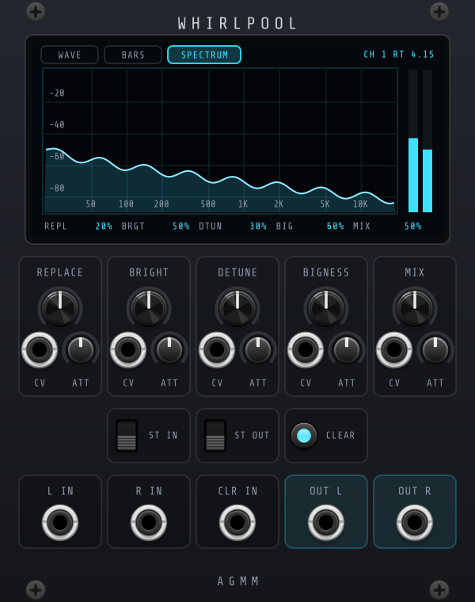

<!--
AGMM AUTOMATIC DOCUMENTATION
Source: Whirlpool.cpp
-->

# Whirlpool

## 1. Overview

`Whirlpool` is a 20 HP polyphonic reverb built around an 8-line Feedback Delay Network (FDN) with a Hadamard feedback matrix. Each of up to 16 voices runs an independent engine, so polyphonic sources such as chords or a poly sequencer reverb per-note instead of being summed to mono. Five controls (REPLACE, BRIGHT, DETUNE, BIGNESS, MIX) each have a CV input and a bipolar attenuverter; there are stereo input / output switches, a clear button with its own trigger input, and a three-mode display (Wave / Bars / Spectrum).

Key features:
- 8-line FDN with an orthonormal 8×8 Hadamard feedback matrix
- Per-voice independence, up to 16 polyphonic voices
- Early reflections, 4-stage input diffusion per side
- Per-line RT60 gain, one-pole damping, smoothly-modulated read positions
- Clear sequence (fade out → reset → fade in)
- Three display modes, switchable from the header

## Module Screenshot

## 2. Architecture

### Main Classes

- `Whirlpool` — core module class inheriting from `rack::Module`
- `WHPanel` — static panel artwork
- `WHDisplay` — 260 × 124 interactive display (three modes)

### Engine namespace: `whengine`

- `whengine::Engine` — one reverb voice (8 delay lines, allpass chain, DC blocker)
- `whengine::Shared` — per-sample control data, shared by all voices
- `whengine::Allpass` — 4-sample allpass diffuser
- `readHermite(...)` — 4-point Hermite interpolation
- `hadamard8(...)` — in-place 8-point orthonormal Hadamard transform

### Inheritance

- `Whirlpool` inherits from `rack::Module`
- `WHPanel` inherits from `rack::TransparentWidget`
- `WHDisplay` inherits from `rack::OpaqueWidget`

### Structures

- `Shared { float delay[8]; float mod[8]; float gain[8]; float erTap[8]; float lpCoef; float inGain; float erLevel; }`
- `Allpass { std::vector<float> buf; int pos; }`

### State (grouped)

| Group | Storage |
|-------|---------|
| Engines | `whengine::Engine engines[16]`, `whengine::Shared sh` |
| Rate / smoothing | `float allocSr`, `float kSmooth`, `float kSize`, `float sizeS, rtS, fcS, detS` |
| Modulation | `float lfoPhase[8]` |
| Clear | `bool clearRequested`, `float clearFade`, `bool clearActive`, `int limiterRecovery` |
| Display — readouts | `int dispMode`, `int dispCh`, `float dispVal[5]`, `float dispLine[8]`, `float dispDelayMs[8]`, `float dispRt60`, `float dispSr`, `float meterOutL, meterOutR` |
| Display — scope | `float scopeMinL/R/I[222]`, `float scopeMaxL/R/I[222]`, `int scopeHead, scopeCount, scopeBinSamples` |
| Display — FFT | `float specBuf[4096]`, `int specPos` |

## 3. DSP Theory

### FDN core

The reverb is an 8-line feedback delay network. Every sample, the current output of each delay line is damped by a one-pole lowpass and scaled by the per-line RT60 gain:

$$
y_i = \text{lp}_i \cdot g_i
$$

then the y-vector is multiplied by an orthonormal 8×8 Hadamard matrix. The scaled input is added before writing back:

$$
\mathbf{f} = H_8 \mathbf{y}, \quad \mathbf{x}_i[w] = f_i + (\text{dl}\cdot P_{L,i} + \text{dr}\cdot P_{R,i}) \cdot g_{\text{in}}
$$

with `H_8` scaled by `1/√8` so that the matrix preserves energy.

### Per-line RT60 gain

For a target RT60 `T` and delay length `d` samples:

$$
g_i = e^{-6.9078 \cdot d / (f_s \cdot T)} = \left(10^{-3}\right)^{d / (f_s T)}
$$

so that after `T` seconds the tail is −60 dB. `g_i` is clamped to `< 0.9995` for stability.

### Damping

One-pole lowpass with cutoff `fc`, per line:

$$
\alpha = 1 - e^{-2\pi f_c / f_s}, \quad \text{lp}_i \leftarrow \text{lp}_i + \alpha (y - \text{lp}_i)
$$

`f_c = clamp(800 \cdot 24^{\text{BRIGHT}}, 0.45 f_s)`.

### Modulation

Each delay line has its own LFO with rate and phase set so that they are mutually incommensurate:

$$
\phi_i \leftarrow \phi_i + (0.12 + 0.065 i + 0.6 \cdot \text{DETUNE}) / f_s, \quad \phi_i \bmod 1
$$

$$
m_i = \sin(2\pi \phi_i) \cdot (16 \cdot \text{DETUNE} \cdot f_s / 48000)
$$

Read positions are `d_i + m_i` from the ring, with 4-point Hermite interpolation.

### Early reflections

Eight taps from a mono-summed ring buffer, alternating L/R output, at fixed times (4.3 – 43.3 ms) scaled by room size. Each tap is weighted by `ER_G[t]` and added to the appropriate side before the DC blocker.

### Input diffusion

Four allpass filters per side, coefficients fixed at `g = 0.6`, lengths in samples:

| Stage | Left | Right |
|---|---|---|
| 1 | 89 | 97 |
| 2 | 131 | 149 |
| 3 | 223 | 241 |
| 4 | 337 | 359 |

### DC blocker

Standard first-order highpass with `R = 0.995`.

### Equal-power dry / wet

$$
\text{out} = d \cdot \cos\!\left(\tfrac{\pi}{2} m\right) + w \cdot \sin\!\left(\tfrac{\pi}{2} m\right)
$$

### Normalisation

The injection gain is reduced as `g_avg` approaches 1 to keep the network from overdriving:

$$
g_{\text{in}} = 0.35 \cdot \left(0.55 + 0.45\sqrt{\max(0, 1 - \bar{g}^2)}\right)
$$

## 4. Parameters and Controls

### 5 knob cells

Each cell has a knob, a left-side CV jack, and a right-side bipolar attenuverter. CV is `0..+10 V = 0..100 %`.

| Parameter | Min | Max | Default | Description |
|-----------|-----|-----|---------|-------------|
| `REPLACE_PARAM` | 0 | 1 | 0 | Shortens the tail (up to 92 %) |
| `BRIGHTNESS_PARAM` | 0 | 1 | 0.5 | Damping cutoff (800 Hz – 19.2 kHz) |
| `DETUNE_PARAM` | 0 | 1 | 0.2 | Modulation depth |
| `BIGNESS_PARAM` | 0 | 1 | 0.6 | Room size + RT60 |
| `MIX_PARAM` | 0 | 1 | 0.5 | Dry / wet |

### Switches and buttons

| Parameter | Description |
|---|---|
| `IN_STEREO_BUTTON_PARAM` | Stereo input toggle (CKSS) |
| `OUT_STEREO_BUTTON_PARAM` | Stereo output toggle (CKSS) |
| `CLEAR_BUTTON_PARAM` | Momentary clear |

## 5. Inputs and Outputs

### Inputs

| Name | Type | Range | Description |
|------|------|-------|-------------|
| `IN_L_INPUT` | Audio | ±10 V | Left / poly |
| `IN_R_INPUT` | Audio | ±10 V | Right |
| `REPLACE_CV_INPUT` | CV | 0..10 V | Replace modulation |
| `BRIGHTNESS_CV_INPUT` | CV | 0..10 V | Brightness modulation |
| `DETUNE_CV_INPUT` | CV | 0..10 V | Detune modulation |
| `BIGNESS_CV_INPUT` | CV | 0..10 V | Bigness modulation |
| `MIX_CV_INPUT` | CV | 0..10 V | Mix modulation |
| `CLEAR_INPUT` | Trigger | 0..10 V | Clear trigger |

### Outputs

| Name | Type | Range | Description |
|------|------|-------|-------------|
| `OUT_L_OUTPUT` | Audio | ±12 V | Left / poly |
| `OUT_R_OUTPUT` | Audio | ±12 V | Right |

### Menu

- **Display** → Wave / Bars / Spectrum

## 6. Signal Processing Pipeline

1. **Allocate** — on sample-rate change, `engines[c].init(sr)` and update `kSmooth` / `kSize` / `scopeBinSamples`.
2. **Detect channels** — mono / poly / stereo-in / stereo-out; set output channel counts.
3. **Read params + CV** — 5 cells via `getParam`.
4. **Smooth targets** — `sizeS`, `rtS`, `fcS`, `detS` with one-pole smoothing (~50 ms / ~120 ms).
5. **Compute `Shared`** — delay lengths, RT60 gains, LFO modulation, ER taps, damping coefficient, injection gain.
6. **Clear sequence** — advance `clearFade` per state machine.
7. **Run voices** — for each active voice, `engines[c].process(sh, dryL, dryR, wetL, wetR)`.
8. **Mix** — equal-power dry / wet; multiply wet by `clearFade`.
9. **Safety** — NaN check → reset all engines + brief mute.
10. **Write outputs** — per voice or summed for stereo-out.
11. **Display feeds** — `dispLine[]` from voice 0, peak meters, scope min/max bins, FFT ring buffer.

## 7. Important Functions

### `void whengine::Engine::init(float sr)`

Allocates the ring buffers (rounded up to the next power of two for masking), early-reflection buffer, allpasses, then calls `reset()`.

### `void whengine::Engine::reset()`

Zeroes delay lines, filters, allpasses, DC blockers and the early-reflection buffer.

### `void whengine::Engine::process(const Shared &s, float inL, float inR, float &wetL, float &wetR)`

Per-sample engine step described in §3.

### `inline float whengine::readHermite(const std::vector<float> &b, int w, float d, int mask)`

4-point Hermite interpolation for a fractional delay read from the ring.

### `inline void whengine::hadamard8(float *x)`

In-place 8-point Hadamard transform (butterfly in three stages, then scaled by `1/√8`).

### `void Whirlpool::process(const ProcessArgs &args)`

Main module callback described in §6.

### `void Whirlpool::allocate(float sr)`

(Re-)initialises every engine for `sr` and refreshes smoothing coefficients and `scopeBinSamples`.

### `float Whirlpool::getParam(int paramId, int attenId, int cvId)`

Combines knob + atten × cv/10, clamped to `[0, 1]`.

## 8. Mathematical Implementation

### Allpass diffuser

$$
v = x - g\,d, \quad d' = v, \quad y = d + g\,v
$$

with `g = 0.6` and per-side lengths as tabulated in §3.

### RT60 feedback gain

$$
g_i = \exp\!\left(-\frac{6.9078 \, d_i}{f_s \, T}\right)
$$

### Per-line damping

$$
\text{lp}_i \leftarrow \text{lp}_i + \alpha\,(y_i - \text{lp}_i), \quad \alpha = 1 - e^{-2\pi f_c / f_s}
$$

### Hadamard matrix (orthonormal, `H H^T = I`)

Three butterfly passes on an 8-element vector, then multiply by `1/√8`:

$$
x \leftarrow \frac{1}{\sqrt{8}}\, H_8 \, x
$$

### Modulation

$$
\phi_i \leftarrow (\phi_i + \tau_i / f_s) \bmod 1, \quad \tau_i = 0.12 + 0.065\, i + 0.6\cdot \text{DETUNE}
$$

$$
m_i = \sin(2\pi \phi_i) \cdot 16 \cdot \text{DETUNE} \cdot f_s/48000
$$

### Bigness → size & RT60

$$
\text{size} = 0.35 + 1.65\, b, \quad T = 0.35 \cdot 60^{\,b} \cdot \left(1 - 0.92\, r\right)
$$

with `b = BIGNESS` and `r = REPLACE`.

### ER tap scaling

$$
\text{erTap}_t = \text{ER\_MS}[t]\cdot 10^{-3} \cdot f_s \cdot (0.4 + 0.8\,\text{size})
$$

## 9. Performance and Optimization

### CPU Usage

- Per voice per sample: 8 Hermite reads (each ~15 flops), 8 one-pole updates, 1 Hadamard (≈ 24 flops), 4+4 allpasses, 8 ER reads, 1 DC blocker per side
- ≈ 400 flops per voice per sample, plus a small controller cost
- At 16 voices: ≈ 6.4 K flops/sample → very manageable

### Memory Allocation

- All buffers allocated in `init()`, none in `process()`
- 16 voices × 8 lines × `next_pow2(~3300)` samples ≈ 16 × 8 × 4096 × 4 B ≈ 2 MB worst case

### Real-time Processing

- All inner loops fixed-size (N = 8)
- No allocation, no locks in the audio path

### Thread Safety

- `Shared` computed once per sample by the module, read-only for all voices
- Display fields written by the audio thread, read by the UI thread via torn reads

### Numerical Stability

- Feedback gain clamped to `< 0.9995`
- Output clamped to `±12 V`
- NaN check → full engine reset with a short recovery mute
- `sizeS`, `rtS`, `fcS`, `detS` smoothed with one-pole filters to avoid clicks

## 10. Dependencies

### Libraries/Headers

- `plugin.hpp` — VCV Rack core
- `agmm_ui.hpp` — shared AGMM UI helpers
- `<cmath>`, `<cstdio>`, `<cstring>`, `<vector>`, `<algorithm>`

### External Classes

- `rack::Module`, `rack::ModuleWidget`, `rack::OpaqueWidget`
- `dsp::SchmittTrigger`
- `agmm::panelBase`, `agmm::bezel`, `agmm::cell`, `agmm::plate`, `agmm::screen`, `agmm::plotFrame`, `agmm::meter`, `agmm::text`, `agmm::accent`, `agmm::bright`, `agmm::violet`, `agmm::warm`, `agmm::dim`, `agmm::withA`, `agmm::ALIGN_L/C/R`

## 11. Summary

`Whirlpool` is a polyphonic FDN reverb that treats every voice as its own reverb tail. The 8-line feedback network with a Hadamard matrix, early reflections, and per-line damping is a well-behaved and physically-motivated reverb topology, and the moderate CPU cost means you can run dozens of instances.

The BARS display mode exposes the internal FDN line levels and delay times, which is a nice debugging aid as well as a performance visual. The clear sequence (fade out → reset → fade in) makes it possible to clear the tail mid-performance without a click, and the smoothing on all control targets means the module never produces zipper noise on fast knob moves or CV steps.