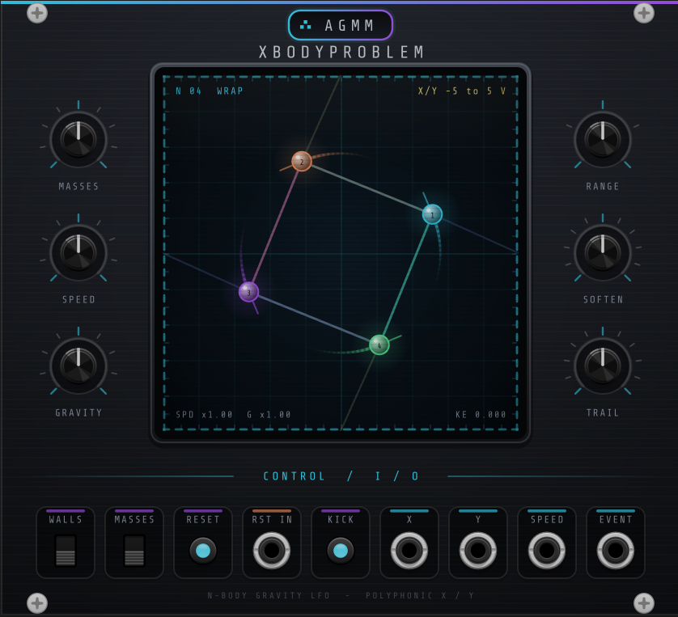

# XBodyProblem — N-Body Gravity LFO for VCV Rack

XBodyProblem is a 28 HP generative modulation source that simulates an **N-body gravitational system** in a unit square and turns the bodies' motion into CV. Instead of a fixed waveform, you get chaotic, quasi-periodic, and emergent movement — useful as a slow LFO, a random source, a stereo modulator, or a polyphonic controller for several parameters at once.

Each body's X position, Y position, speed, and wall-contact events are available as **polyphonic outputs**, so a single module can modulate many targets with correlated but distinct signals.

## Module Screenshot

---

## Features at a glance

- **2 to 10 gravitating bodies**, each with its own position, velocity, and (optionally) mass.
- **Leapfrog integration** with adaptive substepping for stable, energy-conserving motion.
- **Two wall modes**: wrap-around (Pac-Man) or elastic bounce.
- **Equal or random masses** — random masses make the system more asymmetric and unpredictable.
- **Softening** to tame close-encounter singularities.
- **Live square display** showing bodies, gravity links, velocity vectors, trails, centre of mass, and energy.
- **Four polyphonic outputs**: X position, Y position, speed (0–10 V), and wall-event triggers.
- **Five output ranges** from 0 to 1 up to ±10 V.
- **Reset** and **Kick** buttons (with matching trigger input for reset) to re-randomise or perturb the system.
- **Fully patch-persistent**: paused flag, momentum setting, body count, positions, velocities, and masses are saved with the patch.

---

## Panel layout

### Big square display (centre)

A 220 × 220 px screen showing the simulation in a unit square (0…1 in both axes, +Y up).

| Element | Meaning |
|---------|---------|
| **Coloured spheres** | The bodies. Size scales with mass; the number inside is the body index. |
| **Thin lines between bodies** | Gravitational links. Brighter/thicker = stronger current force. |
| **Short line from each body** | Velocity vector (direction and relative speed). |
| **Fading trails** | Each body's recent path. Length is set by the TRAIL knob. |
| **Dashed cyan frame** | Wrap mode: leaving one edge re-enters on the opposite edge. |
| **Solid orange frame** | Bounce mode: bodies reflect off the walls. |
| **White crosshair** | Bounce mode only — centre of mass of the system. |
| **Top-left readout** | Body count, wall mode, and whether masses are random. |
| **Top-right readout** | Current X/Y output range. |
| **Bottom-left readout** | Simulation speed multiplier and gravity multiplier. |
| **Bottom-right readout** | Total kinetic energy of the system. |
| **"PAUSED"** | Shown when the simulation is paused (right-click menu). |

Trails are recorded at 60 Hz, so ~2 seconds of history is visible at full trail length.

### Knobs (three per side)

| Left column | Right column |
|-------------|--------------|
| **MASSES** (2–10) | **RANGE** (0–1 … ±10 V) |
| **SPEED** (×1/16 … ×16) | **SOFTEN** (0–100 %) |
| **GRAVITY** (×1/16 … ×16) | **TRAIL** (0–100 %) |

Each knob has a cyan arc showing its current value; bipolar knobs (SPEED, GRAVITY) fill from the centre and use orange for negative values.

### Control / I/O row (bottom)

| Control | Type | Function |
|---------|------|----------|
| **WALLS** | Switch | Wrap around (Pac-Man) / Bounce |
| **MASSES** | Switch | Equal / Random masses |
| **RESET** | Button + LED | Re-randomise positions, velocities, and masses |
| **RST IN** | Input | Rising edge triggers the same reset |
| **KICK** | Button + LED | Add a random impulse to every body |
| **X** | Output | X position, polyphonic |
| **Y** | Output | Y position, polyphonic |
| **SPEED** | Output | Speed, 0–10 V, polyphonic |
| **EVENT** | Output | 1 ms trigger on wall contact, polyphonic |

---

## Parameters

| Parameter | Range | Default | Notes |
|-----------|-------|---------|-------|
| **MASSES** | 2–10 | 2 | Number of bodies. Snaps to integers. Increasing it while running initialises new bodies at random positions. |
| **SPEED** | ×2⁻⁴ … ×2⁴ | ×1 | Simulation speed. The integrator substeps adaptively so large speeds remain stable. |
| **GRAVITY** | ×2⁻⁴ … ×2⁴ | ×1 | Gravitational constant multiplier. ×1 corresponds to G = 0.05 in the module's units. Negative values make gravity repulsive. |
| **RANGE** | 5 options | −5 to +5 V | Output scaling for X and Y (see table below). |
| **SOFTEN** | 0–100 % | 40 % | Close-encounter smoothing. Higher values make near-collisions gentler and prevent extreme accelerations. |
| **TRAIL** | 0–100 % | 60 % | Trail length shown in the display. Does not affect the audio-rate outputs. |
| **WALLS** | Switch | Wrap | Wrap or Bounce. |
| **MASSES mode** | Switch | Equal | Equal = every body has mass 1. Random = 0.4 … 2.4 per body. |

### Output ranges

| Setting | X / Y output voltage |
|---------|----------------------|
| 0 to 1 | 0 … +1 V |
| −1 to 1 | −1 … +1 V |
| **−5 to 5** | **−5 … +5 V** (default) |
| 0 to 10 | 0 … +10 V |
| −10 to 10 | −10 … +10 V |

The SPEED output is always 0…+10 V, scaled so that speed 1.5 in simulation units maps to 10 V.

---

## Outputs in detail

All four outputs are **polyphonic**, with as many channels as there are bodies.

- **X / Y** — the normalised position (0…1) mapped through the selected range. Bodies stay inside the unit square in both wall modes, so these outputs never exceed the selected range.
- **SPEED** — 0…+10 V, monotonic with the body's current speed. Useful as an envelope follower of the system's activity.
- **EVENT** — a 1 ms trigger (0 or +10 V) each time the corresponding body crosses or reflects off a wall. In wrap mode this fires on each edge crossing; in bounce mode on each reflection. Good for clocked or rhythmic derivations.

---

## Typical uses

- **Slow multi-tap LFO**: with 2–3 bodies and low speed, X/Y give two related, non-repeating slow modulators. Send them to pitch, filter cutoff, or pan.
- **Polyphonic modulation bus**: increase MASSES to 6–10 and feed X or Y into a polyphonic VCO, filter bank, or a Quad module. Each voice gets a distinct but correlated signal.
- **Clock source**: EVENT outputs give irregular triggers whenever a body hits a wall — great for random rhythms, sample-and-hold clocks, or burst envelopes.
- **Energy follower**: SPEED gives a continuous "activity" CV. Use it to open a filter when the system is fast and close it when the system is settling.
- **Stereo pair**: use X into the left side and Y into the right side of a stereo processor for a naturally decorrelated stereo field.
- **Chaotic sequence**: patch a RESET trigger at bar boundaries and use X → quantiser → VCO for an ever-changing melody.

---

## Right-click menu

| Item | Effect |
|------|--------|
| **Pause simulation** | Freezes the physics. Outputs hold their current values. Useful to freeze a modulation state. |
| **Zero total momentum on reset** | When on, the total momentum of the system is subtracted after a reset, so the whole cloud doesn't drift. Default: on. |
| **New random start** | Equivalent to pressing RESET. |

---

## Patch state saved

The following are stored in the patch JSON:

- `paused` — pause flag
- `zeroMomentum` — momentum setting
- `n` — number of bodies
- `px, py, vx, vy, rm` — full simulation state (positions, velocities, random masses)

Because the full state is restored, a saved patch resumes the exact motion that was on screen when it was saved, even if the simulation was mid-orbit.

---

## How the simulation works

Each sample:

1. The body count and all knobs are read.
2. Reset/kick triggers are processed.
3. If not paused, the sample time is scaled by SPEED and divided into up to 16 substeps of at most 2 ms each.
4. Each substep performs one **leapfrog (kick-drift-kick)** integration step:
   - half velocity update from current accelerations,
   - position update,
   - wall handling (wrap or elastic bounce) with event flags,
   - recompute pairwise gravitational accelerations,
   - half velocity update from the new accelerations.
5. Velocities are clamped to 3 units/sample to keep close encounters tame, and accelerations are capped at 400 units to avoid singularities.
6. If any non-finite value appears, the system resets automatically.

Pairwise gravity in wrap mode uses the **minimum image convention** (`dx -= round(dx)`), so a body near one edge feels the correct pull from a body near the opposite edge.

---

## Quick-start recipes

- **Two-body slow LFO**: MASSES = 2, SPEED ×0.25, GRAVITY ×1, RANGE −5…+5. Patch X to filter cutoff and Y to pan.
- **Bouncing drum clock**: WALLS = Bounce, 4–5 bodies, random masses, EVENT → trigger input of a drum voice.
- **Orbital drone**: 3 bodies, MASSES mode = Random, SPEED ×0.5, SOFTEN 60 %. X and Y into two VCOs; SPEED into a VCA.
- **Freeze frame**: set up a nice orbit, then right-click → Pause. Outputs hold; save the patch to freeze it permanently.

---

## Notes and constraints

- The simulation runs in a normalised unit square, so the visual and audio behaviour are independent of the panel size.
- Trails are visual only; they are not written to the patch.
- The display demo (in the module browser) shows a synthetic four-body circle so you can see the visual style before placing the module.
- Polyphony comes from the number of bodies, not from the host's polyphonic input — this module has no audio input.